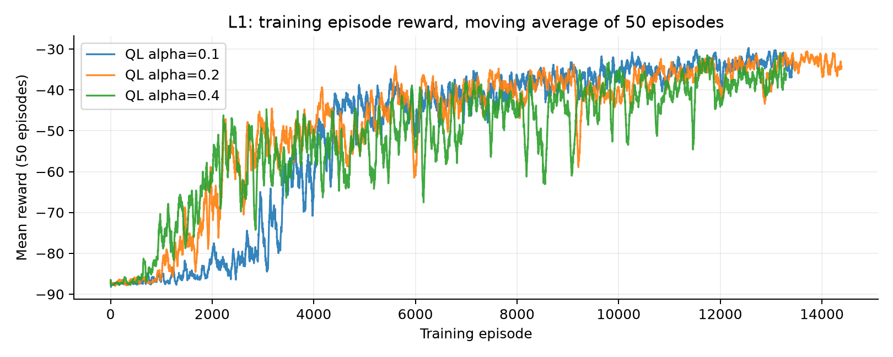
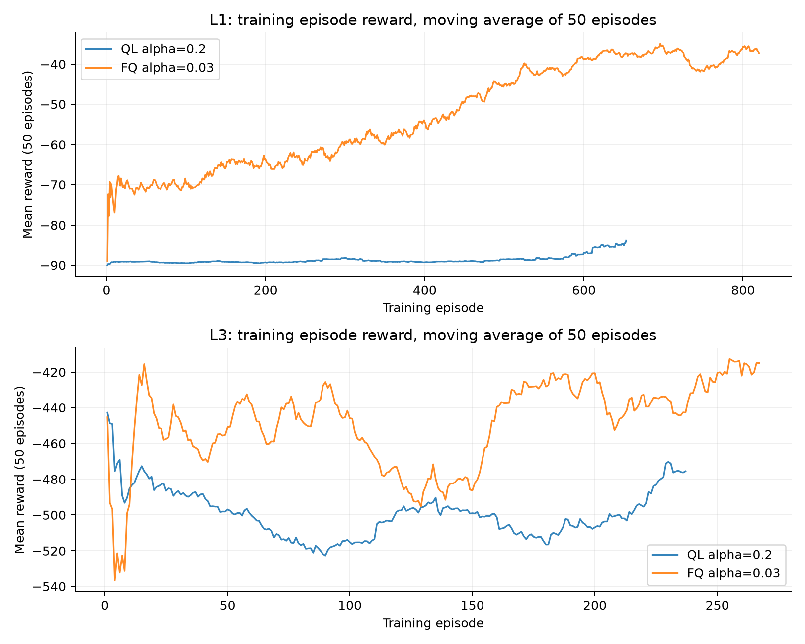

COMP3702 A3 学习工作稿

CrystalRover 强化学习  代码复核与实验记录

这份工作稿供你运行参考实现、核对数据，再独立重写。允许 AI 的部分附代码对应说明和实测图表；禁止 AI 的小问仅保留题目和作答区域。

姓名：________________  学号：________________  邮箱：________________

作业标注截止时间：2026 年 10 月 30 日 16:00。代码与报告各占 50 分。

## Q1 Q learning 与 Value Iteration

本题共 5 分。Q1a 与 Q1b 均禁止 AI。

### Q1a 相似点 2点5分

描述标准表格型 Q-learning 与标准表格型 Value Iteration 的两个关键相似点，答案不超过五行。

[独立作答区域]

### Q1b 不同点 2点5分

描述两个关键不同点，答案不超过五行。不要换一种表述重复同一个核心点。

[独立作答区域]

Q1 的答案由你独立填写。

---

## Q2 实现与学习率实验

### Q2a 实现说明 3分 允许AI但需明确验证

参考 QL 使用 epsilon-greedy。每个 episode 开始时根据已用训练步数计算 epsilon，训练中的贪心并列动作随机打破并列；评估方法使用确定性的贪心选择。

| 参数 | 参考实现设置 |
| --- | --- |
| QL 学习率 | 固定 alpha = 0.2 |
| epsilon | 从 0.25 线性降到 0.02 |
| 衰减区间 | 训练步数预算的前 80% |
| 初始化 | Q 表按需创建，初始 Q 值为 0 |
| 实验候选学习率 | 0.1  0.2  0.4，均为固定值 |

这些值用于演示与复现，不宣称已经最优。最终采用值、替代方案及选择依据，请根据你的实际实验与最终实现补充：________________。

自动检查已核对单步终止更新、合法动作、训练状态链、有限特征与评估不改权重。你的验证记录：检查命令、手算样本、实际观察和发现的问题：________________。

### Q2b 三个固定学习率 4分 允许AI

L1，环境与探索种子 1914。三次独立训练只改变 alpha，均使用官方步数及累计奖励预算；最终策略评估 1000 次。图中为训练回报的 50-episode 移动平均。

| alpha | 训练episode | 评估平均回报 | 成功次数 |
| --- | --- | --- | --- |
| 0.1 | 13,428 | -31.56 | 996/1000 |
| 0.2 | 14,388 | -31.65 | 994/1000 |
| 0.4 | 13,295 | -38.00 | 995/1000 |

---

## Q2c 独立作答

本小问 6 分，禁止 AI。结合自己的图表，讨论学习率对学习速度、稳定性和最终观测表现的影响，解释意外结果及实验限制。

[独立作答区域]

## Q3a 特征设计 4分 允许AI但需明确验证

FQ 使用 21 维固定长度向量，Q 值为学习权重与特征的点积。权重从全 0 开始，以固定 alpha=0.03 做样本半梯度更新。以下为归一化前的特征定义。

| 编号 | 特征 | 计算与作用 |
| --- | --- | --- |
| 0至7 | bias 类型 方向 | 常数、walk/boost/jump 指示、左/右/上/下指示，表示动作类别与朝向。 |
| 8至9 | 目标距离 | 当前格、前方一格的地图 BFS 距离，除以行数加列数。 |
| 10至12 | 朝目标的进展 | 当前距离减前方一格距离；boost 另看两格与四格，除以同一尺度。 |
| 13至14 | 岩浆位置 | 正前方是否岩浆，以及两个侧邻格的岩浆指示平均值。 |
| 15至16 | 岩石与陨石坑 | 正前方格的地形指示，描述方向上的障碍和坑。 |
| 17至18 | 收集进度 | 尚缺样本数除以最低要求，以及是否已满足最低数量。 |
| 19至20 | 目标在前方 | 前方一格是否有未收集水晶；数量足够后是否是发射点。 |

目标在样本不足时是最近未收集水晶，足够后是最近发射点。BFS 仅查看公开地图，将岩石和岩浆视为不可通行，未使用隐藏概率或成本。直线方向查询遇岩石、岩浆或坑时停止，不代表真实随机转移概率。

原始向量统一除以 max(1, L2范数)，保持数值尺度有限。因此归一化后的 bias 不一定是 1。局限是最近目标不代表全程最优目标组合，距离忽略风暴、随机移动和真实动作成本，局部地形也不能描述所有远处风险。

验证请实际提取若干状态与动作的向量，手算对应距离与地形，并用官方特征检查核对长度。你的检查记录与修订：________________。

---

## Q3b 四个关卡的学习权重 2分 允许AI

使用 baseline 中各关卡官方 FQ 预算训练结束后的原始权重。列名与代码 FEATURE_NAMES 一一对应；所有特征都经过前述向量归一化。

| Feature | L1 | L2 | L3 | L4 |
| --- | --- | --- | --- | --- |
| bias | -5.6116 | 2.2012 | -333.3518 | -167.2476 |
| walk | 0.1316 | 2.0101 | -113.0617 | -63.3955 |
| boost | -5.7432 | 2.6319 | -114.5966 | -60.2299 |
| jump | 0.0000 | -2.4408 | -105.6934 | -43.6222 |
| left | -0.9095 | -0.6808 | -83.1122 | -38.9930 |
| right | -0.8573 | 3.7714 | -86.4017 | -45.7872 |
| up | -1.8586 | 4.3092 | -76.0920 | -36.5142 |
| down | -1.9863 | -5.1986 | -87.7458 | -45.9532 |
| target_distance | -32.8363 | -39.6792 | -105.1490 | -104.9193 |
| target_distance_ahead_1 | -42.3131 | -54.5965 | -118.1725 | -115.2836 |
| target_progress_ahead_1 | 9.4768 | 14.9173 | 13.0235 | 10.3643 |
| target_progress_ahead_2 | 1.1236 | 11.1194 | 5.4814 | 7.9385 |
| target_progress_ahead_4 | 1.4927 | 25.4850 | 6.0413 | 6.2557 |
| lava_forward | 0.0000 | 0.0000 | -112.8411 | -149.5981 |
| lava_side | 0.0000 | 0.0000 | -44.9624 | -54.9584 |
| rock_forward | -9.2912 | -19.8659 | -96.5613 | -77.7325 |
| crater_forward | 0.0000 | -14.7261 | -86.4097 | -61.8877 |
| crystals_remaining_fraction | -47.5741 | -79.6931 | -239.4484 | -233.0373 |
| ready_for_launch | 9.6088 | -11.7971 | 34.0911 | 65.7897 |
| uncollected_crystal_ahead | -5.8336 | 0.8100 | -51.7691 | 32.1440 |
| launch_ahead | -6.0808 | -5.9204 | 51.5923 | 108.6143 |

### Q3c 权重解读 6分 禁止AI

结合特征定义讨论权重的符号和大小、是否符合你对良好策略的预期，以及关卡之间的差异。

[独立作答区域]

---

## Q4a QL 与 FQ 实验比较 6分 允许AI

选择 L1 和 L3：L1 为无岩浆走廊地图；L3 包含岩浆、陨石坑且需三个样本，以覆盖不同地形与收集要求。

两种算法每关共用 30000 步上限和相同累计奖励下限，使用相同评估种子、1000 次最终评估与同一个阈值。回报区间取两种官方区间的包络，阈值为下限加区间宽度的 75%。学习率分别为 QL 0.2、FQ 0.03；epsilon 设置相同。

| 关卡 | 累计奖励下限 | 学习阈值 | 评估截断 |
| --- | --- | --- | --- |
| L1 | -58,000.00 | -47.750 | -87.80 |
| L3 | -118,000.00 | -128.825 | -237.80 |

| 运行 | 达标episode | 达标步数 | 平均回报 | 成功次数 |
| --- | --- | --- | --- | --- |
| L1_ql | 未达到 | 未达到 | -89.07 | 11/1000 |
| L1_fq | 167 | 7,208 | -35.10 | 1000/1000 |
| L3_ql | 未达到 | 未达到 | -470.92 | 1/1000 |
| L3_fq | 未达到 | 未达到 | -234.06 | 538/1000 |

阈值来自每 1/25 训练步数预算的一次 50-episode 贪心评估。未达到保留为未达到；训练回报曲线与贪心评估不是同一统计量。

---

## Q4b 概念预测 6分 禁止AI

预测哪种算法学习更快、哪种最终表现更好，并说明理由。讨论表格型和特征型表示的优点、局限、泛化和近似误差。

[独立作答区域]

## Q4c 结果解读与结论 8分 禁止AI

结合自己的图表比较学习轨迹、速度、稳定性与最终质量；核对概念预测，讨论两个关卡的差异，并以实验支持解释。

[独立作答区域]

## 附录 AI声明与参考来源

AI 使用记录草稿：OpenAI Codex 于 2026 年 10 月 26 日协助生成学习参考代码、实验脚本、实测图表及本工作稿允许 AI 的部分。模型版本：按你所用界面实际信息填写。

请按实际情况补充最终保留的内容、你做过的验证与修订。禁止 AI 的答案需由你独立完成，不要声明尚未做过的验证。

参考来源：COMP3702 Assignment 3 CrystalRover Reinforcement Learning，2026，课程提供的作业说明。

官方支持代码与接口：https://github.com/comp3702-2026/2026-Assignment-3-Support-Code

支持代码版本：0e498b0adbe94b0e6b084945e575de3df4988d0e。原始实验数据保存在 results 的三个分组中。
