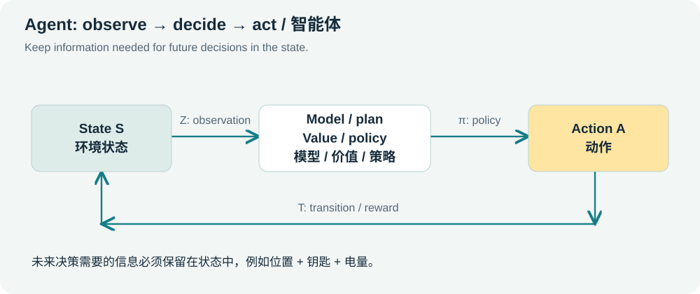
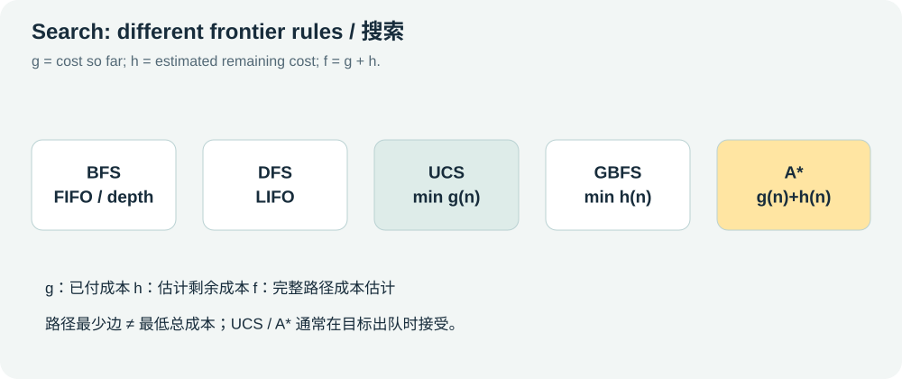
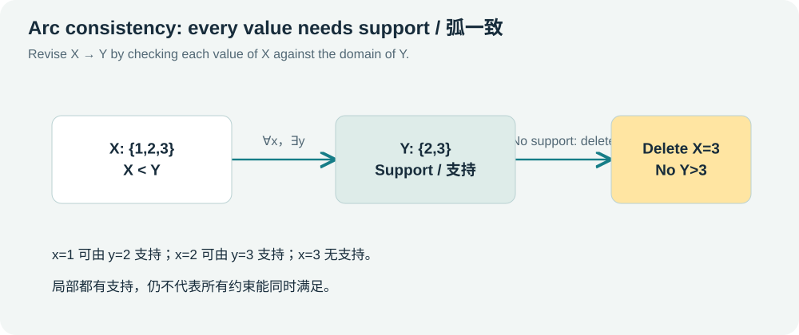
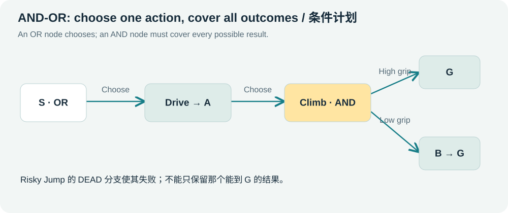
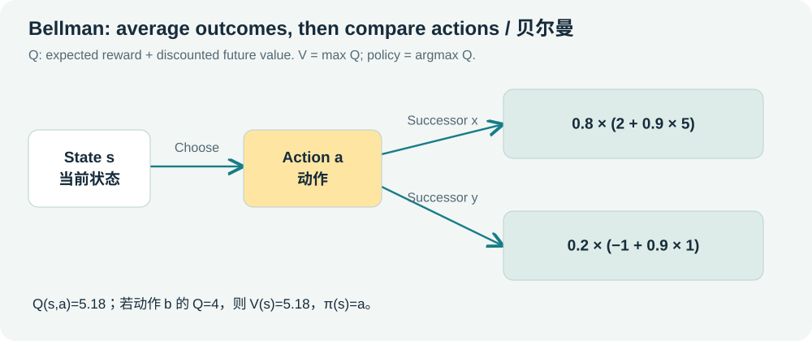
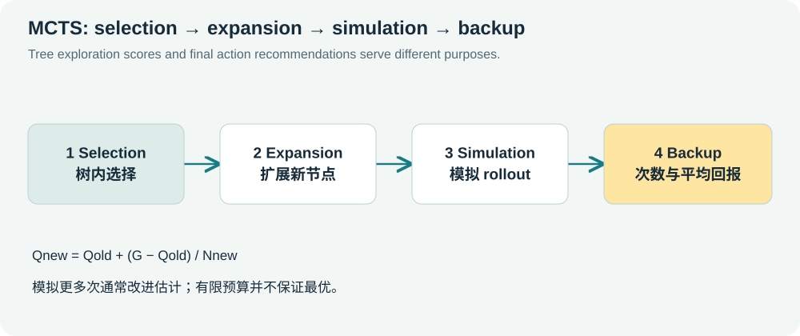
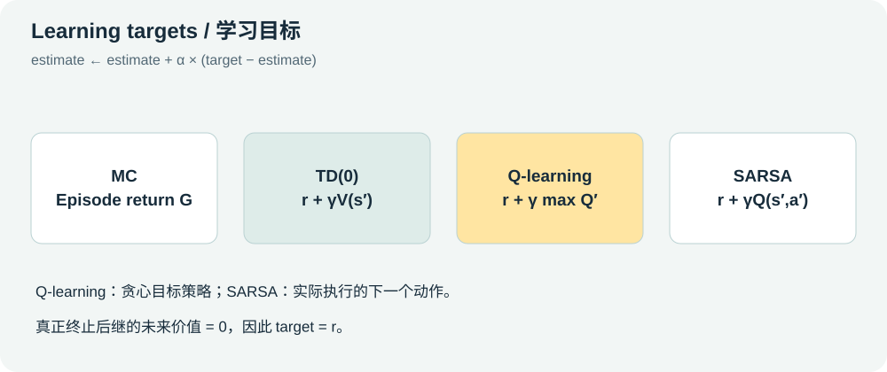
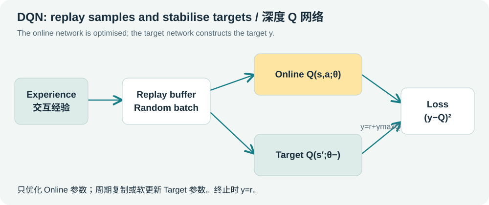
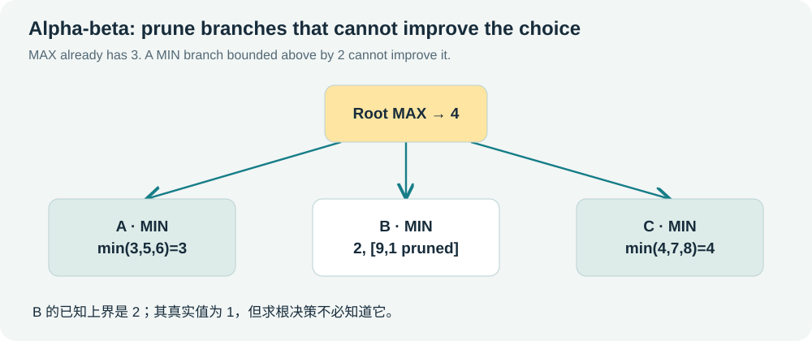

# COMP3702 English-Chinese Study Guide / 中英对照复习主册

# How to study for an English-language exam

Use three passes: read the English explanation first, check the Chinese counterpart when needed, then close both and write a short answer in English. Keep the formulas, assumptions and reasoning explicit. The materials are based on the supplied 2026 course files; the mock papers are original practice, not official exam predictions.

## A four-step loop
1. Understand the model and justify its assumptions against the original PDF.
2. Pause an animation and predict the next expansion, deletion or update.
3. Solve a new problem on paper in English before revealing the answer.
4. Classify errors as modelling, formula, substitution, ordering or explanation errors; retry after a day.

## A suggested 14-day schedule
|Day|Focus|Evidence of learning|
|---|---|---|
|1|Agents, modelling and search basics|Model navigation and a key maze in English|
|2|UCS,GBFS,A*|Trace five searches on one graph|
|3|Heuristics and parity|Give a consistency counterexample and construct a lower bound|
|4|CSP and AC-3|Record domains, deletions and queue reinsertion|
|5|Probability, Markov chains and MEU|Calculate posterior, multi-step distribution and net expected utility|
|6|AND-OR and MDP modelling|Write a conditional plan and a reward-timing convention|
|7|Value iteration|Compute three synchronous sweeps and extract a policy|
|8|PI,RTDP,MCTS|Solve evaluation equations and update one UCT backup|
|9|Bandits|Compute epsilon-greedy,softmax and UCB|
|10|MC,TD,Q-learning,SARSA|Compare targets and update an experience sequence|
|11|VFA and DQN|Calculate exact weights and explain a DQN training step|
|12|Minimax and Nash|Justify cutoffs and solve a mixed equilibrium|
|13|Responsible AI and scope check|Write two causal case analyses and sit mock A|
|14|Mock B and delayed error review|Resit errors without notes and recall the formula sheet|

## Seven-day compression
Day1: agents/search. Day2: CSP/probability/AND-OR. Day3: MDP/VI/PI. Day4: MCTS/bandits. Day5: RL/VFA/DQN. Day6: games/responsible AI/scope. Day7: timed mocks and error review. Prioritise calculations you cannot yet reproduce, rather than repeatedly reading familiar definitions.

## A training target, not a score guarantee
For each core skill, solve at least two different problems unaided and explain the reasoning in English. Aim for 90/100 on each self-marked mock and correctly redo mistakes 24–48 hours later. This is a suggested learning threshold, not a prediction of the real exam. Check the official practice paper and revision announcements when available.

## Files and local records
Open index.html in a system browser. Reading modes are English + Chinese, English only and Chinese only. English-only mode hides the Chinese study text and question translations; it does not certify performance. Progress, answers and notes use this browser's localStorage. Export records for backup; clearing browser data or changing browser/origin can change what records are available.

# 如何用这份资料复习

本包依据本地 2026 课程讲义与 APP 的 tutorials 制作，日期为 2026-10-24（Brisbane）。目标是覆盖与检验能力，不承诺考试分数。没有获得官方期末样卷或最新考试范围；自编题不能代替官方材料。

## 每一章都按四遍循环
1. **理解**：读中文讲解，对照原 PDF 页码解释变量和假设。
2. **观察**：在实验室逐步播放，暂停后预测下一步。
3. **闭卷**：在纸上手算，再打开答案按评分点核对。
4. **纠错**：把错误归到模型、公式、代入、顺序、解释中的一种，间隔一天重做。

## 14 天路线（可按剩余天数压缩）
|天|主任务|当天应交出的学习结果|
|---|---|---|
|1|智能体、建模、Search 基础|独立写导航和钥匙迷宫模型；做诊断题|
|2|UCS/GBFS/A*|同一图五种算法的 frontier 表|
|3|Heuristic / parity|一致性反例、启发式构造、Tutorial 3|
|4|CSP / AC-3|A<B<C 手算；Tutorial 4.5|
|5|概率、Markov、MEU|Bayes、矩阵两步、彩票与净利润|
|6|AND-OR 与 MDP 建模|条件计划；Gridworld 转移表与奖励说明|
|7|VI|同步 3 轮、policy extraction；比较原地更新|
|8|PI / RTDP / MCTS|解线性方程；一轮 UCT 与 backup|
|9|Bandits|ε 概率、softmax、Tutorial 8 UCB|
|10|MC/TD/Q/SARSA|同轨迹四种 target 与顺序更新|
|11|Linear VFA / DQN|Pacman 精确权重；DQN 流程图与简答|
|12|Minimax / Nash|剪枝树、点球混合均衡、Morra 偏离检验|
|13|Responsible AI；逻辑范围核对|两个案例因果链；完成模拟 A 并评分|
|14|模拟 B；错题回测|错题二次闭卷通过；速查表主动回忆|

## 7 天压缩路线
第1天建模+Search；第2天CSP+概率+AND-OR；第3天MDP/VI/PI；第4天MCTS+Bandits；第5天RL+VFA+DQN；第6天博弈+Responsible AI+范围核对；第7天两套模拟与错题。时间不足时优先补“做不出的计算过程”，不要只反复阅读熟悉定义。

## 达标标准（训练建议）
每个核心学习目标至少闭卷做对两道不同题，能用英文关键词写出定义与解释；两套自编卷在自行设定时间内都达到 90/100 以上且错误能复盘；隔 24–48 小时再做错题仍正确。90 分仅是本包的自测门槛，不代表真实考试预测。

## 文件入口
直接双击 index.html，无需安装、联网或账号。章节、实验、题库和进度均在本机运行；进度记录在当前浏览器的 localStorage。不同浏览器或清理数据后进度可能不同，可导出/导入学习记录。PDF 可打印，Markdown 可编辑。


# English exam toolkit / 英文考试答题工具

**ENGLISH**

## How to move from understanding to an English answer

Read the English question without revealing Chinese. Underline the command verb, objective and assumptions. Write the model/equation first, show intermediate calculations, then add one sentence explaining the conclusion. Use the Chinese counterpart to diagnose a misunderstanding only after attempting the answer. Repeat the same skill with different numbers a day later.

**中文对照**

## 如何从理解过渡到英文作答

先只读英文题，圈出指令词、目标与条件。先写模型或公式，再列中间计算，最后用一句英文解释结论。尝试后才看中文诊断理解错误；隔一天换参数再做。

**ENGLISH**

## Precision matters more than elaborate English

Short sentences with accurate terminology are enough. Prefer “This value has no support” to an uncertain long paragraph. Include the condition: “BFS is cost-optimal when all step costs are equal.” Distinguish “not guaranteed” from “always false”, “generated” from “expanded”, “reward” from “return”, and “max” from “argmax”.

**中文对照**

## 准确比复杂句式重要

用短句和准确术语即可。条件要写全，例如BFS在等步成本下才保证成本最优。特别区分“不保证”与“一定不成立”、生成与扩展、reward与return、max与argmax。

**ENGLISH**

## A four-part calculation answer

1. State the convention: “Rewards are paid on exit; V(exited)=0.” 2. Write the governing equation. 3. Substitute and compute with intermediate steps. 4. Interpret: “Action a is selected because its expected discounted return is larger.” Do not give only a number if the question says explain, derive or justify.

**中文对照**

## 四段式计算答案

约定→公式→代入计算→解释。例如先写退出发奖、吸收态值为0，再列Bellman方程，计算各动作Q，最后说明为什么选该动作。要求explain/derive/justify时不能只给数字。

**ENGLISH**

## A comparison answer uses common dimensions

For Q-learning versus SARSA, compare target, target/behaviour policy relationship, terminal handling and behaviour under exploration. For VI versus PI, compare one iteration, model needs, computation per iteration and convergence/termination. A table is often clearer than two unrelated definitions.

**中文对照**

## 比较题要有共同维度

Q/SARSA可比较target、策略关系、终止处理与探索影响；VI/PI可比较一轮工作、模型需求、单轮开销和收敛。用共同维度，避免仅背两个互不连接的定义。

**ENGLISH**

## Practice sequence

Use parallel mode to learn, English-only mode to retrieve, and the English-first written/mocks to practise production. A correct multiple-choice guess is not enough: say why the distractors fail. The suggested 120-minute mock timer is a training choice, not the official exam duration.

**中文对照**

## 推荐训练顺序

中英对照学懂→仅英文回忆→书面题和模拟卷练表达。选对后还要能解释其他选项为什么错。120分钟只是训练建议，不代表官方考试时长。

## Command verbs / 题目指令词

|English|中文|How to respond / 如何作答|
|---|---|---|
|Define|定义|Give a precise meaning and the essential condition. 先写准确含义和必要条件。|
|State|写出|Give the requested fact, formula or assumption directly. 直接给出事实、公式或假设。|
|Describe|描述|Outline the relevant steps or behaviour. 说明步骤或表现。|
|Explain|解释|Give a causal reason; connect the claim with because/therefore. 写原因和因果链，不能只重复结论。|
|Compare / contrast|比较 / 对比|Use common criteria and discuss similarities/differences. 用相同维度比较，而非分别背两段。|
|Compute / calculate|计算|Write the formula, substitute values and show the result. 公式、代入、结果都写。|
|Trace|跟踪执行|Show intermediate states in the exact specified order. 逐步列 frontier、域或更新值。|
|Derive|推导|Show the equations linking assumptions to the result. 给出连接前提与结果的中间等式。|
|Justify|论证理由|Support the conclusion using assumptions or an invariant. 用条件或不变量支撑结论。|
|Prove / show that|证明|Give a logically sufficient argument, not just an example. 例子通常不能替代一般证明。|
|Give a counterexample|给反例|Construct one case satisfying the premises but violating the claim. 反例既满足前提又推翻结论。|
|Formulate|建模表达|Specify variables/states,domains/actions,constraints/transitions and objective. 写清变量、域、约束或状态转移与目标。|
|Determine whether|判断是否|State yes/no and support it; check relevant conditions. 给判断并说明依据。|
|Verify|核验|Check the defining equations,conditions or every relevant deviation. 代入定义、检查全部必要情况。|
|Assume / given that|假设 / 已知|Treat the stated condition as a premise. 已知条件不应擅自替换。|
|Not necessarily|不一定|A guarantee fails; the statement need not always be false. 没有保证不等于一定相反。|
|At least / at most|至少 / 至多|Translate to ≥ / ≤ respectively. 注意不等号方向。|
|For every / there exists|对任意 / 存在|Translate to ∀ / ∃ and preserve their order. ∀x∃y 与 ∃y∀x 不等价。|

## Reusable reasoning structures / 可替换的推理句式

### agent

I define the state as (…). This includes (…) because it affects future actions or rewards. The environment is (…) because (…).

先定义状态，再说明为何某变量不可省略，并为环境分类给依据。

### search

The heuristic is admissible because it never overestimates the remaining cost. It is not consistent on edge (…) since h(n)>c(n,n′)+h(n′). Therefore, an A* implementation that never reopens states need not be optimal.

先分别检验可采纳与一致性，再连接到实现条件；不要从“不一致”直接推出所有A*都会错。

### csp

Value x has no supporting value in D(Y), so REVISE(X,Y) removes it. Since D(X) shrank, arcs Z→X must be reconsidered. Nonempty arc-consistent domains do not, in general, prove satisfiability.

指出无支持值、删值与重入队方向，最后区分局部一致和全局有解。

### prob

By the law of total probability, P(E)=…. Applying Bayes' rule gives P(H∣E)=…. The likelihood and posterior differ because the latter also depends on the prior and alternative causes.

分母先用全概率，再套Bayes并解释似然不等于后验。

### andor

This OR node is solved because at least one action is solved. The chosen AND action must retain every possible outcome. Action (…) fails because its (…) branch reaches an unrecoverable dead end.

OR至少一个；AND覆盖全部；用具体失败分支论证。

### mdp

Using the previous sweep's values, Qₖ(s,a)=…. Taking the maximum over actions gives Vₖ₊₁(s)=…. The extracted policy chooses (…) because its expected discounted return is largest.

声明同步旧值，先算Q再取max，策略用argmax。

### mcts

The exploration bonus is larger for the less-visited action. After the rollout, N increases to (…) and the mean becomes (…). A finite simulation budget does not guarantee the optimal action.

解释探索项、计数和均值，避免把anytime说成有限预算必然最优。

### bandit

The greedy action can also be selected during exploration, so its probability is 1−ε+ε/k. Under the specified UCB formula, the larger bonus can outweigh a smaller empirical mean.

说明探索也能抽到最好动作，并按题目常数位置比较UCB。

### rl

Q-learning uses maxₐ′Q(s′,a′), whereas SARSA uses the value of the action actually selected next. The respective targets are (…) and (…), giving updated values (…) and (…).

比较target后写各自新值；不要只写off-policy和on-policy标签。

### vfa

Using the old weights, the TD error is δ=…. All weights are then updated using the same error: wᵢ←wᵢ+αδfᵢ(s,a). Shared parameters allow generalisation but restrict the representable value function.

先算旧δ再同时更新，说明泛化收益与表达限制。

### deep

Replay reduces temporal correlation and reuses past transitions. The target network slows changes in the bootstrapped target. For a terminal successor, the target is the immediate reward only.

分别说明两个技巧的作用，并正确处理终止target。

### minimax

At this MIN node, β≤α after observing (…). MAX already has an alternative worth at least (…), so the remaining branches cannot improve the root decision and can be pruned.

写出界交叉与祖先已有选择，不能只圈剪枝不写理由。

### nash

To make the opponent indifferent between supported actions, equate (…) and (…). Solving gives (…). Every action outside the support must also give no greater payoff, so no profitable unilateral deviation exists.

令对方无差异，说明概率方向并检查支持集外偏离。

### responsible

The proxy label may encode (…) and cause (…). We would co-design with (…), validate (…), measure group-specific outcomes, and provide human review, appeal and accountable monitoring.

具体机制→措施→指标→复核申诉和责任。

### logic

To test KB⊨α, add ¬α to the knowledge base and check unsatisfiability. Deriving the empty clause by resolution establishes that no countermodel exists.

用反证式SAT检验和空子句解释蕴涵。

## Core terminology / 高频术语

|English term|中文|Meaning in English|
|---|---|---|
|rational agent|理性智能体|An agent choosing actions to maximise expected performance given its information and resources.|
|state space|状态空间|The set of possible configurations relevant to predicting the future.|
|percept / observation|感知 / 观察|Information available to the agent through its sensors.|
|transition model|状态转移模型|The deterministic or probabilistic consequences of an action in a state.|
|fully observable|完全可观测|The agent can determine the relevant current state from its observations.|
|stochastic|随机的|An action can lead to multiple outcomes with specified probabilities.|
|bounded rationality|有限理性|Decision quality is evaluated subject to limited time or computation.|
|planning horizon|规划时域|How far into the future decisions account for consequences.|
|frontier / fringe|待扩展集合 / 边界|Generated search nodes waiting to be selected.|
|expand|扩展|Generate a selected node's successors.|
|successor|后继|A state/node reached by applying an available action.|
|path cost|路径成本|The accumulated cost of the edges along a path.|
|completeness|完备性|The guarantee of finding a solution when one exists under the stated assumptions.|
|optimality|最优性|The guarantee that a returned solution has the best objective value.|
|branching factor|分支因子|The number,or bound on the number,of successors per node.|
|admissible heuristic|可采纳启发式|A heuristic that never overestimates the true remaining cost.|
|consistent heuristic|一致启发式|A heuristic satisfying h(n)≤c(n,n′)+h(n′) on every edge.|
|reopen a state|重新打开状态|Expand a state again after a better path cost is found.|
|tie-breaking|同分处理规则|The rule used to choose among equal-priority nodes.|
|inversion parity|逆序对奇偶性|The inversion count modulo two,used in odd-width puzzle reachability.|
|domain|取值域|The possible values for a variable.|
|constraint|约束|A restriction on legal combinations of variable values.|
|partial assignment|部分赋值|Values assigned to some,but not all,variables.|
|backtracking|回溯|Undo a choice and try an alternative after failure.|
|support|支持值|A compatible value satisfying a constraint with a given value.|
|arc consistency|弧一致性|Every value at the source of an arc has a supporting value at its target.|
|forward checking|前向检查|Propagating a new assignment to prune incompatible neighbour values.|
|constraint propagation|约束传播|Repeated local pruning after domain changes.|
|MRV|最少剩余值|Choose the unassigned variable with the fewest legal values.|
|LCV|最少约束值|Try a value that leaves the most flexibility for neighbours.|
|prior / posterior|先验 / 后验|Belief before / after conditioning on evidence.|
|likelihood|似然|The probability of the evidence conditional on a hypothesis.|
|mutually exclusive|互斥|Events that cannot occur together.|
|independent|独立|Events whose probabilities do not change on conditioning on each other.|
|expected utility|期望效用|The probability-weighted utility of possible outcomes.|
|Markov property|马尔可夫性质|The current state summarises the history needed for the next transition.|
|stationary distribution|平稳分布|A distribution x satisfying xP=x.|
|policy|策略|A mapping from states to actions or action distributions.|
|reward / return|奖励 / 回报|Immediate feedback / accumulated possibly discounted rewards.|
|discount factor|折扣因子|A factor γ weighting future rewards relative to immediate rewards.|
|absorbing state|吸收状态|A state that cannot be left after entry.|
|terminal state|终止状态|A state ending an episode,with no subsequent return.|
|Bellman backup|Bellman 更新|A one-step reward-plus-successor-value computation.|
|policy evaluation|策略评估|Computing the expected return of a fixed policy.|
|policy improvement|策略改进|Choosing better actions relative to the evaluated values.|
|conditional plan|条件计划|A plan whose continuation depends on observed outcomes.|
|rollout|模拟展开|A simulated trajectory used to estimate return.|
|backpropagation in MCTS|MCTS 反向回传|Updating visit and return statistics along the selected search path.|
|anytime algorithm|随时可中断算法|An algorithm that can return a current answer when interrupted.|
|exploration / exploitation|探索 / 利用|Trying uncertain actions / selecting currently high-value actions.|
|upper confidence bound|置信上界|An estimated mean plus an uncertainty-driven exploration bonus.|
|bootstrap|自举估计|Use another current value estimate as part of the learning target.|
|temporal-difference error|时序差分误差|The sampled TD target minus the current estimate.|
|on-policy / off-policy|同策略 / 异策略|Learning the behaviour policy / a possibly different target policy.|
|behaviour policy|行为策略|The policy that generates the observed actions.|
|target policy|目标策略|The policy whose values or performance are being learned.|
|function approximation|函数逼近|Representing values or policies through shared parameters.|
|feature / weight|特征 / 权重|An input descriptor / its learned contribution in an approximator.|
|generalisation|泛化|Applying learned information to unobserved inputs.|
|experience replay|经验回放|Storing transitions and resampling them for training.|
|target network|目标网络|A frozen or slowly updated network used to compute training targets.|
|policy gradient|策略梯度|Optimising policy parameters directly using a return-based gradient.|
|evaluation function|局面评价函数|A heuristic estimate of a nonterminal game state's utility.|
|prune / cutoff|剪枝 / 截断|Skip branches proved irrelevant under the current bounds.|
|upper / lower bound|上界 / 下界|A value guaranteed to be no smaller / no larger than the quantity bounded.|
|zero-sum game|零和博弈|A game in which one player's gain is the other's loss.|
|best response|最佳回应|A strategy maximising utility against fixed opponent strategies.|
|dominant / dominated|占优 / 被支配|At least as good regardless of opponents / inferior to an alternative.|
|mixed strategy|混合策略|A probability distribution over pure strategies.|
|support|策略支持集|The actions assigned strictly positive probability.|
|unilateral deviation|单方面偏离|One player changing strategy while the others stay fixed.|
|indifference condition|无差异条件|Equality of expected payoffs among supported actions.|
|proxy label|代理标签|An observed measure used in place of the underlying target concept.|
|co-design|共同设计|Designing with affected stakeholders rather than only for them.|
|contestability|可争议性|A practical opportunity to question or appeal a decision.|
|accountability|问责|Clear responsibility for decisions,impacts and corrective action.|
|entailment|逻辑蕴涵|Every model of the knowledge base satisfies the conclusion.|
|satisfiable|可满足|True under at least one assignment.|
|valid|逻辑有效|True under every assignment.|
|literal / clause|文字 / 子句|An atom or its negation / a disjunction of literals.|
|conjunctive normal form|合取范式|A conjunction of disjunctive clauses.|
|resolution|消解|An inference rule eliminating complementary literals from two clauses.|


# 01 · Agents & problem formulation / 智能体与建模

**ENGLISH**

## What you must be able to do
Translate a verbal scenario into a computational model and justify its assumptions. An algorithm can be implemented correctly and still solve the wrong problem if the state omits a variable that affects the future.

**中文对照**

## 你要能做到什么
把自然语言题目翻译成可计算的模型，并解释每项假设。如果模型遗漏了影响未来的变量，后面的算法再正确也可能解错问题。



**ENGLISH**

## The six design components
|Component|Meaning|Navigation example|
|---|---|---|
|S: state space|All possible configurations of the world|Position, plus fuel, a key or time when necessary|
|A: action space|Actions available in each state|Traverse a road|
|P/O: percept/observation space|Possible sensor readings|GPS readings and visible traffic|
|T: transition model|How an action changes the state|A successor state or P(s′∣s,a)|
|Z: observation model|How a state produces a percept|Exact or noisy GPS|
|U: utility|How outcomes or trajectories are evaluated|Negative total travel time; search often minimises cost|

A **rational agent** chooses the action with the best expected performance given its information and computational resources. Rationality does not guarantee the best realised outcome and does not require human-like thinking. Budget-limited MCTS illustrates bounded rationality.

**中文对照**

## 六个设计组件
|组件|含义|导航例子|
|---|---|---|
|S · state space|世界所有可能配置|位置；必要时加入燃油、钥匙、时间|
|A · action space|每个状态允许的动作|沿某条道路行驶|
|P/O · percept space|传感器能产生的观察|GPS 读数、可见路况|
|T · transition|动作如何改变状态|确定的后继，或 P(s′∣s,a)|
|Z · observation|状态如何产生观察|准确位置或带噪 GPS|
|U · utility|如何评价结果/整段轨迹|负总行驶时间；搜索常写成最小化路径成本|

**理性（rational）**是根据已有信息和资源选择期望表现最好的动作。它不保证实际结果一定最好，也不要求“像人一样思考”。有限算力下使用 MCTS 是 bounded rationality 的例子。

**ENGLISH**

## Dimensions of complexity
Justify each classification: flat/modular/hierarchical; non-planning/finite/indefinite/infinite horizon; states/features/relations; perfect/bounded rationality; given/learned knowledge; full/partial observability; deterministic/stochastic effects; goals/complex preferences; single/multiple agents; offline/online interaction.

**Sensing uncertainty** concerns whether the agent knows its current state. **Effect uncertainty** concerns whether the next state is determined by the current state and action. A fully observable robot may still slip randomly. A static environment does not change while the agent deliberates; this is different from having deterministic transitions.

**中文对照**

## 复杂性维度
逐项写出理由：flat/modular/hierarchical；non-planning/finite/indefinite/infinite horizon；state/feature/relation representation；perfect/bounded rationality；given/learned knowledge；fully/partially observable；deterministic/stochastic；goal/complex preference；single/multi-agent；offline/online。

**观测不确定性**问“我知道自己在哪吗”；**效果不确定性**问“知道现在状态和动作后，能唯一预测下一状态吗”。完全可观测的滑动机器人仍可能是随机系统。静态问环境会不会在思考时改变，和转移是否随机是两件事。

**ENGLISH**

## Worked model: a maze with a key
Use s=(row,column,key_collected). Two visits to the same cell with different key status must be distinguished if they permit different exit actions or future rewards. The actions are four directions; a collision may leave the agent in place. If sensors reveal the entire state exactly, the model is fully observable. If key status is hidden, a percept is not the full state.

Answer in this order: **S → A(s) → initial state and goal → T → Z/P → utility or cost → justified environment assumptions**. Specify the meaning of a time step. In tic-tac-toe, a step containing both players' moves must model the opponent's response. If a step is one move, the state should identify whose turn it is.

**中文对照**

## 例题：有钥匙的迷宫
状态取 s=(row,col,key_collected)。同一格拿钥匙前后，可用的出口动作和未来回报不同，所以不能合并为同一状态。动作是四方向，撞墙留在原地。若 GPS 精确，则观察可以唯一确定状态；若传感器不报告钥匙，观察空间与完整状态空间不同。

答题模板：**S → A(s) → 初始状态/目标 → T → Z/P → U/成本 → 环境维度与依据**。还要说明动作顺序与一个 time step 的定义。井字棋若一步包含“我方落子+对手回应”，转移模型必须处理对手；若一步只含一个落子，状态应包含轮到谁。

**ENGLISH**

## States, search nodes and trajectories are different counts
A search node may store a state, parent, action and path cost g. Several different paths may reach the same world state. The 3⁹=19,683 possible tic-tac-toe cell configurations are an upper bound; many are illegal. Tutorial 1's 255,168 counts terminal **game sequences**, not distinct legal boards. With X moving first, play stopping on a win, and rotations/reflections counted separately, deduplicated enumeration gives 5,478 reachable boards; the supplied verification script checks this count.

**中文对照**

## 状态、搜索节点与轨迹不是同一个数量
搜索节点通常还记录 parent、action、g。多条路径可以抵达同一状态。井字棋每格三种内容给出 3⁹=19,683 个配置的上界，许多配置不合法。Tutorial 1 的 255,168 是合法终局**对局序列**的数量，不能当作独立合法棋盘数量。按 X 先手、获胜即停止、旋转反射仍区分的规则，去重枚举可得 5,478 个可达棋盘（本包验证代码附在 scripts 中）。

**ENGLISH**

## Closed-book check
Why do two identical positions with different key status represent different states? Why can a rational action still lose? Why can multiple search nodes represent one world state?

**中文对照**

## 闭卷自检
为什么位置相同、钥匙不同是不同状态？为什么理性动作也可能输？为什么多条搜索节点路径可以只对应一个世界状态？

### Use this structure in an exam / 英文答题句式

**ENGLISH**

I define the state as (…). This includes (…) because it affects future actions or rewards. The environment is (…) because (…).

**中文对照**

先定义状态，再说明为何某变量不可省略，并为环境分类给依据。

### Source references / 资料定位

- Module 0 · Introduction: PDF pp. 45–71; `lecture/COMP3702_Module-0_IntroToAI.pdf`.
- Tutorial 1: PDF pp. 1–3; `APP/COMP3702_Tutorial_1(1).pdf`.

### Mastery check / 闭卷自查

- Specify the six agent components and justify environmental assumptions. / 给新情境写出六个组件并说明环境假设
- Distinguish states, percepts, search nodes and trajectories. / 区分状态、观察、搜索节点与路径

# 02 · Search & heuristics / 搜索与启发式

**ENGLISH**

## General structure and exam conventions
The frontier contains generated nodes waiting to be expanded. Remove a node, test for a goal, and generate successors. An explored set usually records expanded states; a reached/visited set usually records generated states. **State the tie-breaking rule, successor order, goal-test timing and duplicate-handling rule.** Different valid implementations can have different expansion orders. For UCS/A*, accepting a goal when it is generated can return a suboptimal path; normally accept it when it is removed as the best frontier node.

|Algorithm|Selection rule|Completeness|Optimality|Typical implicit-tree complexity|
|---|---|---|---|---|
|BFS|FIFO; shallowest first|Finite branching and a finite-depth solution|Fewest steps; minimum cost for equal step costs|Time/space O(bᵈ), the course's common convention|
|DFS|LIFO; deepest first|Not in general; exhaustive on a finite graph with correct duplicate handling|Not in general|Time O(bᵐ); frontier space O(bm)|
|IDDFS|Depth limits 0,1,2,…|Finite branching and finite solution depth|Minimum cost for equal step costs|Time O(bᵈ), space O(bd)|
|UCS|Smallest g|Finite branching; step costs at least ε>0|Minimum path cost|Time/space O(b^(1+⌊C*/ε⌋))|
|GBFS|Smallest h|Not in general; finite graph search can exhaust reached states|Not in general|Can be exponential; depends on h|
|A*|Smallest g+h|UCS-type assumptions and a suitable heuristic|Subject to the conditions below|Usually exponential; memory is often limiting|

Here b is branching factor, d is shallowest goal depth, m is maximum tree depth and C* is optimal cost. Some BFS pseudocode generates a further layer before a removal-time goal test, giving O(b^(d+1)); follow the supplied pseudocode. DFS frontier space does not include a global visited table, which may require O(∣V∣) memory. On an explicit finite graph, BFS/DFS are also commonly analysed as O(∣V∣+∣E∣). Bidirectional BFS can reduce idealised time/space to O(b^(d/2)) when reverse search and efficient meeting detection are available.

**中文对照**

## 总体结构与考试约定
frontier 存待扩展节点。取出一个节点，做 goal test，再展开后继。explored 通常指已扩展；reached/visited 通常指已生成。**先声明同分规则、后继顺序、判目标时机和重复状态规则**，否则展开顺序可能有多个正确答案。UCS/A* 通常在最小优先级节点出队时接受目标；刚生成目标就停止可能得到次优解。



|算法|取点规则|完备性条件|最优性|典型树搜索复杂度|
|---|---|---|---|---|
|BFS|FIFO，最浅层|有限分支且解深度有限|等步长成本时最优|时间/空间 O(bᵈ)，本课常用写法|
|DFS|LIFO，最深|一般不保证；有限图且正确去重时可穷尽|一般不最优|时间 O(bᵐ)，frontier 空间 O(bm)|
|IDDFS|深度上限 0,1,2,…|有限分支且有限深度解|等步长成本时最优|时间 O(bᵈ)，空间 O(bd)|
|UCS|最小 g|有限分支，步成本≥ε>0|最低总成本|时间/空间 O(b^(1+⌊C*/ε⌋))|
|GBFS|最小 h|一般不保证；有限图去重可穷尽|一般不最优|最坏可指数，依赖 h|
|A*|最小 g+h|同 UCS 且合适 h|见下方条件|通常指数；内存常是瓶颈|

b 是分支因子，d 是最浅解深度，m 是最大树深，C* 是最优成本。若 BFS 判目标在出队，可能生成下一层，某些教材写 O(b^(d+1))；按题目的伪代码与讲义口径解释即可。DFS 的 O(bm) 不包括额外存整张 visited 表；全图去重可能需要 O(∣V∣) 内存。有限显式图 BFS/DFS 的另一种计数口径是 O(∣V∣+∣E∣)，不要与隐式树的指数口径混用。

**ENGLISH**

## Admissibility and consistency
```math
Admissible: 0 ≤ h(n) ≤ h*(n), with h(goal)=0.
Consistent: h(n) ≤ c(n,n′)+h(n′) for every directed edge.
A*: f(n)=g(n)+h(n).
```
Admissibility is a lower-bound condition on remaining cost. Consistency also constrains neighbouring estimates. With h(goal)=0, consistency implies admissibility, but the converse does not hold.

An admissible heuristic suffices for optimal A* tree search under the usual positive-cost/finite-branching conditions. Graph search can use admissibility when it **reopens a state after discovering a better g**. If expanded states are never reopened, require consistency. Consistency guarantees optimal g when a state is first **expanded**, not when it is first **generated**.

Proof idea: if a suboptimal goal of cost C>C* were selected, some frontier node n on an optimal path would satisfy f(n)≤C*<C. A* would have selected n first, a contradiction.

**中文对照**

## 可采纳与一致
```math
admissible: 0 ≤ h(n) ≤ h*(n), h(goal)=0
consistent: h(n) ≤ c(n,n′) + h(n′)  对每条有向边
A*: f(n)=g(n)+h(n)
```
可采纳只比较估计和真实剩余成本；一致性还要求相邻点满足三角不等式。目标 h=0 时，一致 ⇒ 可采纳；反向不成立。

树搜索 A* 用可采纳 h 可保证最优。图搜索若更好路径允许重新打开节点，可采纳通常足够；若 expanded 后永不重开，应要求一致性。**一致性保证首次扩展时的 g 最优，不保证首次生成时 g 最优**。

最优性证明：若返回目标成本 C>C*，最优路径上还应有 frontier 节点 n，满足 f(n)≤C*<C；算法应先取 n，与目标已先被选中矛盾。

**ENGLISH**

## One graph, five different behaviours
Directed edges: S→A:2, S→B:1, A→C:2, A→G:9, B→C:2, B→D:6, C→G:3, D→G:1. Heuristics h(S,A,B,C,D,G)=(5,5,4,3,1,0). Test goals on removal. BFS marks states when generated; DFS marks them on popping and prefers the left branch. Priority searches retain better g values and break priority ties by insertion order.

|Algorithm|Removal order, including goal|Returned path|Cost|
|---|---|---|---|
|BFS|S,A,B,C,G|S-A-G|11|
|DFS|S,A,C,G|S-A-C-G|7|
|UCS|S,B,A,C,G|S-B-C-G|6|
|GBFS|S,B,D,G|S-B-D-G|8|
|A*|S,B,C,G|S-B-C-G|6|

A* first generates A:(g=2,h=5,f=7) and B:(1,4,5), selects B, then C:(3,3,6), then G:(6,0,6). **The expansion/removal sequence is not the solution path.**

**中文对照**

## 一道图题看懂区别
使用交互实验中的有向图：S→A:2，S→B:1，A→C:2，A→G:9，B→C:2，B→D:6，C→G:3，D→G:1。h(S,A,B,C,D,G)=(5,5,4,3,1,0)。目标出队时停止；BFS 生成时去重，DFS 出栈时去重且优先左侧，UCS/GBFS/A* 保留更小 g 并按入队顺序打破优先级平局。

|算法|取出顺序（含目标）|返回路径|成本|
|---|---|---|---|
|BFS|S,A,B,C,G|S-A-G|11|
|DFS|S,A,C,G|S-A-C-G|7|
|UCS|S,B,A,C,G|S-B-C-G|6|
|GBFS|S,B,D,G|S-B-D-G|8|
|A*|S,B,C,G|S-B-C-G|6|

A* 展开 S 后 A:(g=2,h=5,f=7)、B:(1,4,5)；先 B，再 C:(3,3,6)，再生成 G:(6,0,6)，最后取 G。**展开顺序和返回路径不是同一列表**。

**ENGLISH**

## Constructing and comparing heuristics
For four-neighbour movement with minimum step cost c_min, Manhattan distance multiplied by c_min is a lower bound. Recheck the argument if diagonal moves are allowed. For the 8-puzzle, misplaced-tile count and Manhattan distance exclude the blank; Manhattan dominates misplaced-tile count. Solving a relaxed problem often gives a lower bound for the original problem.

If h₁,h₂ are admissible, max(h₁,h₂) is admissible and at least as informative as either one. Their sum need not be admissible because it can double-count cost. Scaling by k∈[0,1] preserves admissibility; scaling above 1 generally does not. Raw inversion count also needs a proof before it can be used as an admissible heuristic.

**Tutorial 3 subtlety:** h₂=h₁+5 need not be admissible, but adding the same constant to every node, including goals, leaves frontier ordering unchanged because f₂=f₁+5. The same correctly implemented A* therefore returns the same result. “Not admissible” does not mean “always suboptimal”. This argument does not apply to 2h₁. Since 0≤h₁∣cos(πh₁)∣≤h₁, that transformed heuristic remains admissible. cos(πh₁) alone may be negative or overestimate the true cost and has no general guarantee.

**中文对照**

## 构造与比较启发式
四邻格最小每步成本 c_min 时，可用 Manhattan×c_min；允许斜走后需重新审查。8-puzzle 的 misplaced tiles / Manhattan 都不计空格，Manhattan 支配 misplaced。放松限制得到更容易问题的最优成本通常是原问题下界。

若 h₁,h₂ 可采纳，max(h₁,h₂) 仍可采纳且至少同样有信息；h₁+h₂ 可能重复计算，不自动可采纳。若 0≤k≤1，kh₁ 可采纳；乘以大于 1 的数一般无保证。原始 inversion count 也不能未经证明直接当作 admissible heuristic。

**Tutorial 3 的关键反例**：h₂=h₁+5 不可保证可采纳，但若给所有节点（包括目标）都加同一常数，f₂=f₁+5，优先级排序不变；采用相同正确实现时仍有与原 A* 相同的结果。不要把“非可采纳”误写成“一定不最优”。2h₁ 没有这种保序保证。h₁∣cos(πh₁)∣≤h₁，因此非负且可采纳；cos(πh₁) 会变负或超过真实成本，一般无保证。

**ENGLISH**

## 8-puzzle parity
Flatten the board row by row, ignore the blank and count inversions. On a 3×3 board, legal moves preserve inversion parity. Start and goal must have the same parity. For a nonstandard goal, compare both parities or renumber tiles by their goal order. Even-width puzzles additionally depend on the blank's row; do not apply the odd-width rule unchanged.

**中文对照**

## 8-puzzle parity
按行展平，忽略空格；计算逆序对。3×3 棋盘中合法移动保持逆序对奇偶性；初始与目标 parity 相同才可达。若目标不是标准数字顺序，必须比较双方 parity，或按目标顺序重新编号。偶数宽棋盘还要考虑空格行，不能照搬 3×3 规则。

### Use this structure in an exam / 英文答题句式

**ENGLISH**

The heuristic is admissible because it never overestimates the remaining cost. It is not consistent on edge (…) since h(n)>c(n,n′)+h(n′). Therefore, an A* implementation that never reopens states need not be optimal.

**中文对照**

先分别检验可采纳与一致性，再连接到实现条件；不要从“不一致”直接推出所有A*都会错。

### Source references / 资料定位

- Module 1 · Search: PDF pp. 20–36, 40–60, 73–89; `lecture/COMP3702_Module-1_Search.pdf`.
- Tutorial 2: PDF pp. 2–4; `APP/COMP3702_Tutorial_2(1).pdf`.
- Tutorial 3: PDF pp. 1–3; `APP/COMP3702_Tutorial_3(1).pdf`.

### Mastery check / 闭卷自查

- Trace the frontier and returned path for BFS, DFS, UCS, GBFS and A*. / 手推 BFS/DFS/UCS/GBFS/A* 的 frontier 和最终路径
- Test admissibility/consistency and state the conditions for optimal A*. / 检验可采纳、一致性并解释 A* 最优条件
- Compare complexity and test 8-puzzle parity. / 比较复杂度并检查 8-puzzle parity

# 03 · Constraint satisfaction / 约束满足与 AC-3

**ENGLISH**

## Model the problem before choosing an algorithm
A CSP=(X,D,C) consists of variables, their domains and constraints specifying legal combinations. A solution is a complete assignment satisfying every constraint. For a crossword, variables can be word slots, domains are candidate words, length gives unary constraints, crossing letters give binary constraints, and word reuse can be prohibited by all-different constraints.

Backtracking assigns one variable at a time and rejects a partial assignment as soon as an evaluable constraint is violated. The worst case still has dⁿ complete assignments for n variables of domain size d, but early rejection prunes entire subtrees that generate-and-test would inspect.

**中文对照**

## 模型先于算法
CSP=(X,D,C)：变量、各变量的域、限制合法组合的谓词。**解**是给所有变量赋值且满足全部约束。填字游戏可把每个词槽作为变量，域为可用单词，长度是一元约束，交叉字母相同是二元约束，单词不得复用可写 all-different。

Backtracking 每次固定一个变量，只要当前可判断的约束冲突就回溯。若 d 个值、n 个变量，最坏 dⁿ 个完整赋值；相比无视冲突直到末尾的 generate-and-test，能提前剪掉整棵子树。

**ENGLISH**

## Three levels of checking
|Method|What it does|What it does not guarantee|
|---|---|---|
|Domain/node consistency|Removes values violating unary constraints|Compatibility between variables|
|Forward checking|After assigning X=x, removes incompatible values from unassigned neighbours|Repeated propagation between unassigned variables|
|Arc consistency|Repeatedly ensures every domain value has support across each directed arc|Global satisfiability in general|

```math
X→Y is consistent iff ∀x∈D(X), ∃y∈D(Y): C(x,y).
```
Different x values may use different supporting y values. The condition does not require one y to support every x.

**中文对照**

## 三种检查
|方法|做什么|不保证什么|
|---|---|---|
|Domain/node consistency|删掉违反一元约束的值|不检查跨变量组合|
|Forward checking|新赋值 X=x 后删邻居不兼容的值|不反复传播未赋值邻居间的影响|
|Arc consistency|对每条有向弧反复保证每个值有支持|一般不能证明全局有解|



```math
X→Y consistent ⇔ ∀x∈D(X), ∃y∈D(Y): C(X=x,Y=y)
```
这句里的 ∀ 和 ∃ 最容易考错。支持可以对不同 x 选择不同 y，并不是找一个 y 支持所有 x。

**ENGLISH**

## AC-3 pseudocode
Initialise the queue with all directed arcs. Remove (X,Y), delete each x lacking support in D(Y), and fail if D(X) becomes empty. If D(X) shrinks, reinsert **(Z,X)** for other neighbours Z of X: a Z value may have lost its supporting x. Continue until the queue is empty. The original column contains full pseudocode. When combining propagation with backtracking, restore deleted values on leaving a branch.

**中文对照**

## AC-3 伪代码
```python
queue = all_directed_arcs()
while queue:
    X, Y = queue.pop(0)
    if revise(X, Y):         # 只删除 D(X) 中无支持的值
        if not D[X]:
            return FAILURE
        for Z in neighbours[X] - {Y}:
            queue.append((Z, X))
return DOMAINS
```
删除 X 的值后要复查 **Z→X**，因为原来依赖被删 x 的 Z 值可能失去支持。不是只查 X→Z。实现时保存域快照；回溯离开分支后必须恢复删掉的值。

**ENGLISH**

## Worked propagation: A<B<C
Initially D(A)=D(B)=D(C)={1,2,3}. One valid processing order is:

1. A→B deletes A=3, leaving A={1,2}.
2. B→A deletes B=1, leaving B={2,3}.
3. B→C deletes B=3, leaving B={2}; reinsert A→B.
4. C→B deletes C=1,2, leaving C={3}.
5. A→B deletes A=2, leaving A={1}.
6. The final assignment is uniquely (1,2,3).

A valid processing order reaches the same reduced domains, but intermediate states and operation counts depend on queue conventions. Follow a specified queue order when asked to count checks.

**中文对照**

## 手算：A<B<C
初始 D(A)=D(B)=D(C)={1,2,3}。一种合法队列过程：

1. A→B：A=3 无 B>3，删 3，A={1,2}。
2. B→A：B=1 无 A<1，删 1，B={2,3}。
3. B→C：B=3 无 C>3，删 3，B={2}；重新加入 A→B。
4. C→B：只有 C=3 支持 B=2，删 C=1,2。
5. A→B：只有 A=1 支持 B=2，删 A=2。
6. 队列耗尽，唯一解 (1,2,3)。交互实验逐弧展示域变化。

最终域不依赖合法处理顺序，但中间过程和检查次数依赖顺序。题目若要数次数，必须遵循给定队列策略。

**ENGLISH**

## Three possible outcomes after AC
An empty domain proves failure. Singleton domains forming a consistent network give a solution. Multiple remaining values mean the problem may or may not be satisfiable and may require search. A triangle whose adjacent vertices must differ is arc-consistent with two colours, yet has no global two-colouring.

**中文对照**

## AC 完成后的三种结局
出现空域 ⇒ 无解；所有域均为单值且网络约束已一致 ⇒ 得到解；仍有多值 ⇒ 可能有解也可能无解，需要继续搜索。反例：三角形三顶点只用两种颜色，任意相邻顶点不等。每个值都有邻居支持，所以 arc-consistent，但整体无解。

**ENGLISH**

## Ordering heuristics and complexity
MRV selects the unassigned variable with the fewest legal values; degree can break ties. LCV orders that variable's values by how little they constrain its neighbours. MRV exposes failure early; LCV preserves flexibility for finding a solution.

For binary AC-3, a common worst-case time bound is O(ed³), or O(n²d³) on a dense graph, with e arcs/constraints in order of magnitude and maximum domain size d. Space is typically O(e+nd). Do not apply this bound without qualification to continuous domains or arbitrary higher-arity constraints.

**中文对照**

## 搜索顺序与复杂度
MRV：先选剩余合法值最少的变量；degree 可用于打破平局。LCV：对选中变量优先尝试使邻居删值最少的值。前者希望尽早暴露失败，后者希望保留未来选择。

二元 AC-3 常见最坏时间 O(ed³)，空间 O(e+nd)，e 是弧/约束数量的量级，d 是最大域大小；稠密图 e=O(n²) 时写 O(n²d³)。数值域连续或高元约束不能不加说明套这个界。

**ENGLISH**

## Tutorial 4.5: checking a scheduling answer
From A>3, F∈{5,6} and A>F, infer A=6,F=5. Then ∣A−B∣=2 and even B imply B=4. With all-different, D<A, E∉{1,6} and ∣E−C∣=1, one valid assignment is (A,B,C,D,E,F)=(6,4,1,3,2,5). Distinguish unary-consistent domains, arc-consistent domains and one complete solution; a value in one solution is not automatically the only possible domain value.

**中文对照**

## Tutorial 4.5 答题检查
由 A>3、F∈{5,6}、A>F 得 A=6、F=5；由 ∣A−B∣=2 且 B 偶数得 B=4。再结合 all-different、D<A、E∉{1,6}、∣E−C∣=1 可取 (A,B,C,D,E,F)=(6,4,1,3,2,5)。先区分“经过一元约束后的域”“AC 后的域”和“最终一个解”，不能提前把某个解当成所有可能值。

### Use this structure in an exam / 英文答题句式

**ENGLISH**

Value x has no supporting value in D(Y), so REVISE(X,Y) removes it. Since D(X) shrank, arcs Z→X must be reconsidered. Nonempty arc-consistent domains do not, in general, prove satisfiability.

**中文对照**

指出无支持值、删值与重入队方向，最后区分局部一致和全局有解。

### Source references / 资料定位

- Module 2 · CSP: PDF pp. 9–42; `lecture/COMP3702_Module-2_CSPs_2026(1).pdf`.
- Tutorial 4: PDF pp. 1–3; `APP/COMP3702_Tutorial_4(1).pdf`.

### Mastery check / 闭卷自查

- Formulate crossword or scheduling problems as CSPs. / 把填字/排班题写成 CSP
- Trace AC-3 deletions and queue reinsertion. / 逐弧执行 AC-3 并记录删值和重入队
- Explain the limits of arc consistency and the roles of MRV/LCV. / 解释 AC 无法保证有解与 MRV/LCV 的作用

# 04 · Probability & expected utility / 概率、Markov 链与决策理论

**ENGLISH**

## Essential probability rules
```math
P(A∣B)=P(A∩B)/P(B), provided P(B)>0.
P(A∪B)=P(A)+P(B)−P(A∩B).
P(A∩B)=P(A)P(B∣A)=P(B)P(A∣B).
P(A∣B)=P(B∣A)P(A) / ΣᵢP(B∣Aᵢ)P(Aᵢ).
E[X]=Σₓ xP(X=x).
```
Mutually exclusive events cannot occur together. Independent events do not change each other's probabilities. Two mutually exclusive events of positive probability are not independent. A PMF sums to 1; a PDF integrates to 1. Density can exceed 1, and a continuous random variable has zero probability at any single point. The CDF is F(x)=P(X≤x). A fixed pseudorandom seed supports reproducibility, not automatic correctness or independence of samples.

**中文对照**

## 必会概率公式
```math
P(A∣B)=P(A∩B)/P(B),  P(B)>0
P(A∪B)=P(A)+P(B)−P(A∩B)
P(A∩B)=P(A)P(B∣A)=P(B)P(A∣B)
P(A∣B)=P(B∣A)P(A) / Σᵢ P(B∣Aᵢ)P(Aᵢ)
E[X]=Σₓ xP(X=x)
```
互斥（mutually exclusive）表示不能同时发生；独立（independent）表示知道一个不会改变另一个的概率。两个概率都大于零的互斥事件不会独立。

PMF 对离散值求和为 1；PDF 对区间积分才是概率，密度值可大于 1，连续变量单点概率为 0。CDF F(x)=P(X≤x)。抽样时固定 seed 有助复现，不会使样本分布必然正确或样本之间自动独立。

**ENGLISH**

## Worked Bayes calculation
Given P(H)=.1, P(E∣H)=.8 and P(E∣¬H)=.2, total probability gives P(E)=.8×.1+.2×.9=.26. Therefore P(H∣E)=.08/.26=4/13≈.3077. The likelihood .8 is not the posterior: it conditions in the opposite direction and omits the prior and alternative causes.

**中文对照**

## Bayes 手算
设事件 H 的先验 P(H)=0.1，P(E∣H)=0.8，P(E∣¬H)=0.2。则 P(E)=0.8×0.1+0.2×0.9=0.26，P(H∣E)=0.08/0.26=4/13≈0.3077。**0.8 是似然，不能直接当后验**。

**ENGLISH**

## Markov chains
The Markov property means that, conditional on the current state, the next-state distribution does not require the full history. In a row-stochastic transition matrix P, a row is the current state and a column is the next state. Entries are nonnegative and each row sums to 1. For a row distribution xₜ, xₜ₊₁=xₜP and xₖ=x₀Pᵏ.

For P=[[.5,.5,0],[.2,.5,.3],[0,.5,.5]], x₀=[0,0,1] gives x₁=[0,.5,.5] and x₂=[.1,.5,.4]. A stationary distribution satisfies xP=x and Σxᵢ=1; here it is [.2,.5,.3]. A finite irreducible, aperiodic chain converges to its unique stationary distribution from any initial distribution. A periodic chain may have a stationary distribution while x₀Pᵏ oscillates. The six-cell reflecting random walk in Tutorial 5 has uniform stationary mass 1/6 per cell.

**中文对照**

## Markov 链
Markov property：给定当前状态后，下一状态的条件分布无需完整历史。转移矩阵 P 的行是当前状态，列是下一状态，每行非负且和为 1。行向量分布 xₜ 满足 xₜ₊₁=xₜP，因此 xₖ=x₀Pᵏ。

Tutorial 5 的三状态例子：
```math
P=[[.5,.5,0],[.2,.5,.3],[0,.5,.5]]
x₀=[0,0,1] → x₁=[0,.5,.5] → x₂=[.1,.5,.4]
stationary: xP=x, Σxᵢ=1 → x=[.2,.5,.3]
```
有限链不可约且非周期时，从任意初始分布迭代会收敛到唯一平稳分布。周期链可能有平稳分布，但 x₀Pᵏ 不收敛；例如两个状态确定来回跳。教程六格反射随机游走的平稳分布为每格 1/6。

**ENGLISH**

## Decision theory: utilities first, expectations second
Maximum expected utility selects a*=argmaxₐΣₒP(o∣a)U(o). Expected money is the appropriate criterion only when utility is linear in money. Concave utility commonly models risk aversion; convex utility models risk seeking. In general E[U(X)]≠U(E[X]).

Rational-preference axioms include completeness, transitivity, monotonicity, continuity, substitutability and decomposability. For example, [0.4:A,0.6:[0.5:B,0.5:C]] reduces to [0.4:A,0.3:B,0.3:C]. Completeness permits comparison; transitivity prevents preference cycles; monotonicity favours a higher probability of a better outcome. Continuity permits an equivalent lottery between extreme outcomes, and substitutability permits replacement of indifferent outcomes.

For the lecture's used car, good/bad utilities are 60/−100 and the bad-car probability is .2: EU=.8×60−.2×100=28>0, so buy under this utility model. At bad-car probability p the expectation is 60−160p, with threshold p=.375. For Tutorial 5's rental options, compare first-year net profit including purchase costs: five GenCars 42,250; two unmodified Teslas −725; two upgraded Teslas 8,775. Choose GenCars, rather than comparing only daily rent or the best-case outcome.

**中文对照**

## 决策理论：先定义效用，再求期望
MEU：a*=argmaxₐ ΣₒP(o∣a)U(o)。期望金钱只在以金钱线性定义效用时等于期望效用。风险厌恶常用凹效用，风险偏好常用凸效用；不能把 U(E[X]) 与 E[U(X)] 混同。

理性偏好公理：completeness（可比较）、transitivity（传递）、monotonicity（好结果概率更高更优）、continuity（中间结果可与两端彩票无差异）、substitutability（无差异项可替换）、decomposability（复合彩票按概率展开）。例如 [0.4:A,0.6:[0.5:B,0.5:C]] 等价 [0.4:A,0.3:B,0.3:C]。

**讲义二手车**：好车效用 60，坏车 −100，坏车概率 0.2，买车 EU=0.8×60−0.2×100=28，比不买 0 高。坏车概率为 p 时买车净期望 60−160p，临界 p=0.375。

**Tutorial 5 租车**：统一“第一年净利润”口径，把购买成本也算入。5 辆 GenCar 为 42,250；2 辆 Tesla 为 −725；改装 Tesla 为 8,775，因此选 GenCar。不能只比较每天租金或只比较最好情景。

**ENGLISH**

## Discounted return
```math
Gₜ=Rₜ₊₁+γRₜ₊₂+γ²Rₜ₊₃+… = Rₜ₊₁+γGₜ₊₁.
Constant reward r and γ<1: G=r/(1−γ).
With ∣R∣≤Rmax, truncating after k rewards gives error ≤γᵏRmax/(1−γ).
```
For rewards [2,0,10] and γ=.9, G=2+.9×0+.81×10=10.1. Do not discount the first immediate reward. An episodic task with γ=1 may have finite return, but an infinite positive-reward loop need not.

**中文对照**

## 折扣回报
```math
Gₜ=Rₜ₊₁+γRₜ₊₂+γ²Rₜ₊₃+… = Rₜ₊₁+γGₜ₊₁
恒定每步回报 r，0≤γ<1：G=r/(1−γ)
若 ∣R∣≤Rmax，忽略前 k 步之后的尾部，误差≤γᵏRmax/(1−γ)
```
例：[2,0,10]，γ=0.9，回报为 2+0+0.81×10=10.1。不要把第一笔即时回报也乘 γ。γ=1 的终止任务可有有限回报，但无限期有正奖励的循环不再有有限折扣值。

### Use this structure in an exam / 英文答题句式

**ENGLISH**

By the law of total probability, P(E)=…. Applying Bayes' rule gives P(H∣E)=…. The likelihood and posterior differ because the latter also depends on the prior and alternative causes.

**中文对照**

分母先用全概率，再套Bayes并解释似然不等于后验。

### Source references / 资料定位

- Week 6 · Probability / AND-OR / Decision Theory: PDF pp. 12–25, 45–69; `lecture/COMP3702_Module-3-Part1_Wk6_Probability_AND-ORTrees_DecisionTheory(1).pdf`.
- Tutorial 5 · Solutions: PDF pp. 1–3, 5–6; `APP/COMP3702_Tutorial_5_soln.pdf`.

### Mastery check / 闭卷自查

- Apply Bayes, total probability and expected utility. / 计算 Bayes、全概率与期望效用
- Construct transition matrices and compute multi-step/stationary distributions. / 写出转移矩阵并计算多步/平稳分布
- Compute discounted returns and explain preference axioms. / 计算折扣回报并解释偏好公理

# 05 · AND-OR search / 非确定性与条件计划

**ENGLISH**

## Why a fixed action sequence may be insufficient
Deterministic search returns a path. When an action has multiple possible outcomes, later actions may need to depend on what is observed. A solution is then a conditional plan or policy subtree. At an OR state node, the agent chooses an action; one solved action suffices. At an AND action node, the environment determines the result; all possible outcomes must be solvable for a strong plan. Goals are solved, unrecoverable dead ends are closed, and unexpanded/undecided nodes are not automatically failures.

**中文对照**

## 为什么固定动作序列不够
确定性搜索输出一条路径；动作可能有多个结果时，计划需要根据实际观察选择后续动作。解通常是**条件计划/策略子树**。



OR 状态节点：由 agent 选择动作，有一个 solved 动作就 solved。AND 动作节点：由环境产生结果，所有可能结果都可解决才 solved。目标 solved；不可恢复死路 closed；尚未展开或证明的节点可以是 unsolved，不能直接当失败。

**ENGLISH**

## Tutorial 5.2: complete solved/closed reasoning
At S, Safe Drive reaches A, whereas Risky Jump reaches either G or DEAD. At A, Scan loops to A and Climb reaches G or B. From B, Bridge reaches G.

1. G is solved and DEAD is closed.
2. Jump is closed because one outcome is DEAD, even though another is G.
3. Bridge and therefore B are solved.
4. Both Climb outcomes, G and B, are solved, so Climb and A are solved.
5. Drive and therefore S are solved.

The conditional plan is **Drive; Climb; if the result is B, execute Bridge; if it is G, stop.** It keeps every Climb outcome but only one chosen action at each relevant OR node.

**中文对照**

## Tutorial 5.2 的完整逻辑
S 有 Safe Drive→A 和 Risky Jump→{G,DEAD}。A 有 Scan→A 和 Climb→{G,B}。B 有 Bridge→G。

1. G solved，DEAD closed。
2. Jump 有 DEAD 结果，所以 AND 节点 closed，虽然另一个结果直接到 G。
3. Bridge solved，所以 B solved。
4. Climb 的 G 与 B 都 solved，所以 Climb solved，A solved。
5. Safe Drive solved，因此 S solved。

得到：**Drive；Climb；若到 B 则 Bridge；若到 G 则结束。** 这个计划包含 Climb 的全部结果分支，只保留 S、A 各一个选定动作。

**ENGLISH**

## Cycles require a stated notion of success
For an acyclic strong plan, a branch revisiting an ancestor can be closed. A cyclic “retry until success” plan needs additional assumptions such as fairness or appropriate repeated success probabilities. Almost-sure eventual success is not a guarantee of finite success on every possible outcome sequence. Neither “all cycles are solved” nor “all cycles are impossible” is valid without context.

**中文对照**

## 循环必须说明成功定义
若采用无环强计划，搜索路径中重复祖先状态可关闭该分支。某些允许循环的计划会“只要没成功就重试”：这需要公平性或每次有适当成功概率等额外条件。不能因为存在概率成功的出口就宣称对任意环境结果序列保证有限步成功；也不能说所有循环一定无解。

**ENGLISH**

## AND-OR, expectimax and minimax
|Setting|Decision/action level|Outcome level|
|---|---|---|
|Strong reachability plan|OR: at least one successful action|AND: every possible outcome reaches the goal|
|Known stochastic MDP|maximise expected return|Probability-weighted sum|
|Rational zero-sum opponent|MAX|MIN: the worst outcome for MAX|

Do not replace an expectation by a minimum unless a worst-case model is intended. Do not assume an adversary chooses uniformly at random.

**中文对照**

## AND-OR、Expectimax、Minimax 的关系
|环境/目标|动作/决策层|结果层|
|---|---|---|
|强可达计划|OR：至少一个动作成功|AND：所有结果可达目标|
|已知概率的 MDP|max 期望回报|按概率加权求和|
|零和理性对手|minimax 的 MAX|minimax 的 MIN，取最坏情况|

计算概率题时不能把平均值换成 min；对手模型题也不能假设对手随机均匀。

### Use this structure in an exam / 英文答题句式

**ENGLISH**

This OR node is solved because at least one action is solved. The chosen AND action must retain every possible outcome. Action (…) fails because its (…) branch reaches an unrecoverable dead end.

**中文对照**

OR至少一个；AND覆盖全部；用具体失败分支论证。

### Source references / 资料定位

- Week 6 · Probability / AND-OR / Decision Theory: PDF pp. 28–42; `lecture/COMP3702_Module-3-Part1_Wk6_Probability_AND-ORTrees_DecisionTheory(1).pdf`.
- Tutorial 5 · Solutions: PDF pp. 3–5; `APP/COMP3702_Tutorial_5_soln.pdf`.

### Mastery check / 闭卷自查

- Label an AND-OR tree and extract a complete conditional plan. / 给 AND-OR 树逐层标 solved/closed 并提取条件计划
- Distinguish strong/cyclic plans, expectation and worst-case reasoning. / 区分强计划、循环计划、期望与最坏情景

# 06 · Markov decision processes / MDP、价值迭代与策略迭代

**ENGLISH**

## MDP inputs and outputs
An MDP specifies S,A,T,R,γ, and possibly an initial state s₀. States are fully observable, action effects may be stochastic, and transitions satisfy the Markov property. A solution is a policy, not merely a single path. A finite-horizon policy may depend on time, πₜ(s); alternatively include remaining time in the state. Deterministic and stationary describe different properties.

**中文对照**

## MDP 的输入与输出
MDP=(S,A,T,R,γ)，可另给初始状态 s₀。状态完全可观测，动作影响随机转移，满足 Markov property。输出是状态到动作的策略 π，而非仅一条起点到终点路线。有限时域常需要时间相关 πₜ(s)，把剩余时间纳入状态也可表达；deterministic 和 stationary 是不同性质。



**ENGLISH**

## The meanings of V, Q, R and π
```math
Vπ(s)=Eπ[Gₜ∣Sₜ=s].
Qπ(s,a)=Σₛ′T(s,a,s′)[R(s,a,s′)+γVπ(s′)].
Vπ(s)=Σₐπ(a∣s)Qπ(s,a).
Q*(s,a)=Σₛ′T(s,a,s′)[R(s,a,s′)+γV*(s′)].
V*(s)=maxₐQ*(s,a); π*(s)∈argmaxₐQ*(s,a).
```
R is immediate reward. V is expected discounted return from a state. Q is expected return after taking a specified first action and then continuing with the stated policy. A deterministic π returns an action. **max returns a value; argmax returns a maximising action.**

**中文对照**

## V、Q、R、π 各是什么
```math
Vπ(s)=Eπ[Gₜ∣Sₜ=s]
Qπ(s,a)=Σₛ′ T(s,a,s′)[R(s,a,s′)+γVπ(s′)]
Vπ(s)=Σₐ π(a∣s)Qπ(s,a)  （确定性策略时取指定动作）
Q*(s,a)=Σₛ′ T(s,a,s′)[R(s,a,s′)+γV*(s′)]
V*(s)=maxₐ Q*(s,a),   π*(s)∈argmaxₐ Q*(s,a)
```
R 是单步回报；V 是从状态开始的预期总折扣回报；Q 是先做某动作再继续的总回报；π 返回动作（或分布）。max 返回数值，argmax 返回取得最大值的动作。

**ENGLISH**

## A Bellman backup worked step by step
Action a reaches x with probability .8, reward 2 and V(x)=5, or y with probability .2, reward −1 and V(y)=1. With γ=.9:
```math
Q(s,a)=.8(2+.9×5)+.2(−1+.9×1)=5.18.
```
If action b gives 4 and terminates, Q(s,b)=4, so the new value is 5.18 and the greedy action is a. Compute reward plus discounted successor value on each branch, multiply by its probability, sum over outcomes, and only then maximise over actions.

**中文对照**

## Bellman 手算模板
动作 a：0.8 到 x，奖励 2，V(x)=5；0.2 到 y，奖励 −1，V(y)=1。γ=.9。
```math
Q(s,a)=.8(2+.9×5)+.2(−1+.9×1)=5.18
```
若动作 b 确定得到 4 并终止，Q(s,b)=4，因此 V 新值 5.18，策略选 a。每个分支都先计算 R+γV，再乘分支概率，再相加；最后才跨动作取 max。

**ENGLISH**

## Synchronous value iteration
Start with V₀=0. Every state update in sweep k+1 uses only Vₖ:
```math
Vₖ₊₁(s)=maxₐΣₛ′T(s,a,s′)[R(s,a,s′)+γVₖ(s′)].
Δ=maxₛ∣Vₖ₊₁(s)−Vₖ(s)∣.
```
Example: B exits for 10 into absorbing E; A can move to B for 0 or exit for 4; E has zero reward; γ=.9. The vectors (A,B,E) are V₀=(0,0,0), V₁=(4,10,0), V₂=(9,10,0), and V₃=(9,10,0). Extracting a policy using V₁ already favours moving from A to B, since 9>4. Distinguish a value sweep from a subsequent policy-extraction pass. In-place updates use new values within the same sweep and give different intermediate tables.

For γ<1 and bounded rewards, the optimal Bellman operator is a γ-contraction, so VI converges to a unique V*. If Δ=∥Vₖ₊₁−Vₖ∥∞, then ∥Vₖ₊₁−V*∥∞≤γΔ/(1−γ). A policy can become optimal before values converge exactly, but a few unchanged actions alone are not a general proof of optimality.

**中文对照**

## VI：同步手算
从 V₀=0 开始，每轮所有状态仅使用上一轮 Vₖ。
```math
Vₖ₊₁(s)=maxₐ Σₛ′ T(s,a,s′)[R(s,a,s′)+γVₖ(s′)]
Δ=maxₛ∣Vₖ₊₁(s)−Vₖ(s)∣
```
例：B 的 exit 动作获 10 到 E；A→B 奖励 0；A 也可直接获 4 到 E；E 吸收且奖励 0。γ=.9。

|k|A|B|E|
|---|---|---|---|
|0|0|0|0|
|1|4|10|0|
|2|9|10|0|
|3|9|10|0|

注意 V₁(A)=4，但用 V₁ 提取下一步策略时已会选去 B（比较 9 与 4）。**哪轮 value 对应哪次提取的 policy，要写清定义**。原地更新在同轮使用最新值，数表会不同；题目没允许时不要混用。

γ<1、有界奖励时 Bellman 最优算子是 γ-contraction，故 VI 收敛到唯一 V*。可用 Δ 作为停止标准；若 Δ=∥Vₖ₊₁−Vₖ∥∞，则 ∥Vₖ₊₁−V*∥∞≤γΔ/(1−γ)。策略可能在价值完全收敛前已正确，但仅看到几个动作不变不能普遍证明最优。

**ENGLISH**

## Policy iteration: evaluation then improvement
With a fixed deterministic policy, remove the max:
```math
Vπ=rπ+γPπVπ; (I−γPπ)Vπ=rπ.
rπ(s)=Σₛ′T(s,π(s),s′)R(s,π(s),s′).
πnew(s)∈argmaxₐΣₛ′T(s,a,s′)[R(s,a,s′)+γVπ(s′)].
```
If staying in A gives reward 1 each step and γ=.9, Vπ(A)=1+.9Vπ(A)=10. An exit paying 12 improves this policy; re-evaluation gives 12. If no state has a strictly better action, the policy is stable and optimal under the standard finite discounted assumptions. Keeping the old action on ties prevents needless switching. Usually rπ is a transition-averaged reward vector, not a universal action-independent r(s). Solve the linear system rather than explicitly computing an inverse in code.

|Method|One iteration|Typical dense-model time|Model needed?|
|---|---|---|---|
|VI|Bellman sweep over states and actions|O(∣S∣²∣A∣)|Yes|
|PI|Fixed-policy evaluation and improvement|O(∣S∣³+∣S∣²∣A∣)|Yes|
|Modified PI|Partial evaluation and improvement|Depends on evaluation sweeps/representation|Yes|

PI often needs fewer but more expensive iterations; it is not always faster overall. There are at most ∣A∣^∣S∣ deterministic stationary policies, not ∣A∣×∣S∣. Generalised policy iteration describes the interaction of evaluation and improvement.

**中文对照**

## PI：评估与改进分开
固定 π 后不取 max：
```math
Vπ=rπ+γPπVπ
(I−γPπ)Vπ=rπ
rπ(s)=Σₛ′T(s,π(s),s′)R(s,π(s),s′)
πnew(s)∈argmaxₐ Σₛ′T(s,a,s′)[R(s,a,s′)+γVπ(s′)]
```
小例：策略在 A 选“每步奖励 1 并留 A”，γ=.9，所以 Vπ(A)=1+.9Vπ(A)=10。另一个动作 exit 得 12，所以改进为 exit，重新评估 V=12。若所有状态都不能严格改进，策略稳定并最优。平局时保留旧动作避免无意义来回切换。

一般 rπ 是按转移平均后的即时奖励，不一定是一个与动作无关的 r(s)。代码优先解线性系统而非显式算逆。

|算法|一轮做什么|稠密转移典型单轮时间|需要已知模型|
|---|---|---|---|
|VI|每状态比较所有动作|O(∣S∣²∣A∣)|是|
|PI|固定策略评估+贪心改进|O(∣S∣³+∣S∣²∣A∣)|是|
|Modified PI|有限次评估+改进|依评估次数与表示而定|是|

PI 往往轮数少但单轮更贵；“总是更快”不成立。确定性平稳策略数量最多 ∣A∣^∣S∣，不是 ∣A∣×∣S∣。GPI 指策略评估与策略改进相互作用的总体框架。

**ENGLISH**

## Three Gridworld pitfalls
**Collisions:** combine probabilities of directions leading to the same successor. In the upper-left corner, choosing Up with success .8 and sideways probabilities .1/.1 gives self-loop probability .9 and right-move probability .1. Each (s,a) distribution still sums to 1.

**Keys:** Tutorials 6/8 require key status in the state. The visual VI lab deliberately uses a no-key, Tutorial-7-style simplification; its values are not the answers for the full key problem.

**Reward timing:** the lab pays 0 on entering a coloured cell and +1/−1 on taking exit there. Hence V(coloured cell)=its exit reward, while V(exited)=0. A neighbour receives that reward one discounted step later. If a problem instead rewards entry into a terminal cell, that terminal has zero future value and the previous transition pays immediately. Either model is valid if used consistently.

Under Tutorial 5.4's exit convention, always-right values for s₁,s₂,s₃,s₄ are (10γ⁴p²,10γ³p²,10γ²p²,10γp); always-left values are (5γ,5γ²,5γ³p,5γ⁴p²). At γ=.9,p=.8, right from s₂ gives 4.6656 versus left 4.05.

**中文对照**

## Gridworld 的三个大坑
1. 撞墙/障碍留在原格时，多种方向结果可能到同一状态，概率要**相加**，每个 (s,a) 的概率和仍为 1。例如左上角执行 Up：Up .8 与 Left .1 都撞墙，留原地 .9，Right .1。
2. Tutorial 6/8 有钥匙，状态应带 key。教学实验为了突出 VI，使用 Tutorial 7 风格无钥匙简化版，并明确标注，不能冒充带钥匙题的结果。
3. 奖励时点：本包格子实验进入彩色格奖励 0，在格子执行 exit 才得 +1/−1，到 exited 后 0。于是 V(彩色格)=奖励，V(exited)=0。从邻格移动到彩色格会多乘一次 γ。若题目规定进入终点立即给奖励，则终点 V=0，用另一套模型；两者都可自洽，但不能混在一道题里。

Tutorial 5.4 的约定为 exit 发奖：向右 V(s₁,s₂,s₃,s₄)=(10γ⁴p²,10γ³p²,10γ²p²,10γp)。向左对应 (5γ,5γ²,5γ³p,5γ⁴p²)。γ=.9,p=.8 时 s₂ 向右=4.6656，向左=4.05，故两者相比右更好。

### Use this structure in an exam / 英文答题句式

**ENGLISH**

Using the previous sweep's values, Qₖ(s,a)=…. Taking the maximum over actions gives Vₖ₊₁(s)=…. The extracted policy chooses (…) because its expected discounted return is largest.

**中文对照**

声明同步旧值，先算Q再取max，策略用argmax。

### Source references / 资料定位

- Week 7 · MDP / VI / PI: PDF pp. 11–58; `lecture/COMP3702_Module-3-Part2_Wk7_MDPs_VI_PI(1).pdf`.
- Week 8 · PI / RTDP / MCTS: PDF pp. 15–33; `lecture/COMP3702_Module-3-Part2_Wk8_MDPs_PI_QLearning.pdf`.
- Tutorial 6: PDF pp. 1–3; `APP/COMP3702_Tutorial_6.pdf`.
- Tutorial 5 · Solutions: PDF pp. 7–8; `APP/COMP3702_Tutorial_5_soln.pdf`.

### Mastery check / 闭卷自查

- Formulate an MDP with an explicit reward-timing convention. / 从自然语言构造 MDP 并统一奖励时点
- Compute synchronous VI, policy extraction and PI evaluation equations. / 手算同步 VI、策略提取与 PI 线性方程
- Compare VI/PI and correctly combine collision probabilities. / 比较 VI/PI 并正确累加碰撞概率

# 07 · Online planning & sampling / 在线规划、RTDP 与 MCTS

**ENGLISH**

## From offline computation to a current-state decision
VI/PI normally solve for a policy across the state space; this may be too expensive to store or compute. Online planning spends a limited budget on the current decision, acts, then replans. Online is not synonymous with model-free: MCTS can perform model-based planning using a simulator.

RTDP simulates trajectories from the starting state, takes currently greedy actions, performs a Bellman backup at visited states, and samples the next state from the model. It focuses computation on relevant regions. Optimality requires suitable visitation, initialisation and other assumptions; following one greedy path is not an unconditional guarantee.

**中文对照**

## 从全状态离线计算到当前状态决策
VI/PI 一般为整个状态空间求策略，大空间可能无法存储或计算。在线规划在当前状态分配有限预算，决定一个动作后再规划。它并不等于 model-free；MCTS 可以使用模拟器进行 model-based planning。

RTDP 从起点模拟轨迹，按当前价值贪心选择动作，只对访问状态执行 Bellman backup，然后从转移模型采样下一状态。它把计算集中在相关区域；最优收敛依赖访问覆盖、初始化等条件，不能把“只走一条贪心路径”理解为无条件保证最优。



**ENGLISH**

## The four phases
1. **Selection:** descend through the existing tree using a tree policy, often UCB/UCT, to balance exploration and exploitation.
2. **Expansion:** add an unexpanded action/successor at an expandable nonterminal node. Do not expand a genuinely terminal node.
3. **Simulation/rollout:** use a default policy and simulator to sample a return, ending at termination or a depth cutoff.
4. **Backpropagation/backup:** update counts and return estimates along the visited path in reverse order. For a stochastic MDP, average sampled returns; do not maximise over all chance outcomes.

```math
UCT(s,a)=Q̄(s,a)+c√[ln N(s)/N(s,a)].
Nnew=Nold+1; Q̄new=Q̄old+(G−Q̄old)/Nnew.
```
Try unvisited actions first, or assign them infinite priority, to avoid division by zero. A larger c increases exploration. The tree policy's exploration score is not necessarily the final recommendation rule: the final root action may be chosen by mean return or visit count, as specified.

**中文对照**

## 四个阶段
1. **Selection**：在已有树中按 tree policy（常用 UCB/UCT）向下选择，平衡利用和探索。
2. **Expansion**：在可扩展的非终止节点加入未展开动作/后继。真正的终止节点不再展开。
3. **Simulation / Rollout**：从新节点用默认策略和模拟器得到一条到终止或截断深度的回报。
4. **Backpropagation / Backup**：沿访问路径逆向更新计数和均值；随机 MDP 中按所选路径的折扣回报更新，不能把所有机会结果一律取最大。

```math
UCT(s,a)=Q̄(s,a)+c√[ln N(s)/N(s,a)]
Nnew=Nold+1
Q̄new=Q̄old+(G−Q̄old)/Nnew
```
未访问动作优先尝试或把其分数视为 +∞，避免除以零。Q̄ 是平均回报，N(s) 是节点访问数，N(s,a) 是动作次数。c 越大越偏探索。树内用于探索的 UCB 决策，和预算用尽时返回根动作的规则不是同一件事；后者可按均值或访问数，需按题目规定。

**ENGLISH**

## Worked backup
An edge has N=3 and mean Q̄=2; a new rollout gives G=6. Its new count is 4 and mean is 2+(6−2)/4=3. If the preceding edge has reward 1 and γ=.9, its sampled return is 1+.9×6=6.4, not simply 6.

**中文对照**

## 一次 backup 例题
某边有 N=3、均值 Q̄=2；新 rollout 从该边出发的回报 G=6。新计数 4，新均值 2+(6−2)/4=3。若这条边上方一步奖励为 1 且 γ=.9，上方边应接收 G_parent=1+.9×6=6.4，不是简单复制 6。

**ENGLISH**

## Comparisons and limitations
MCTS needs a generative simulator, not necessarily an explicit transition-probability table. Rollouts are simulated interactions, not repeated executions in the real world. Anytime means it can return its current recommendation when interrupted; it does not guarantee finite-budget optimality. Rollout policy, depth, branching and budget affect estimates.

When reading the supplied mcts.py, check whether a count is old or new. If N has already been incremented, using (Q×N+G)/(N+1) again gives the wrong mean. This package uses the incremental formula above and verifies it numerically.

**中文对照**

## 你应能比较
MCTS 只需 generative simulator，不一定需要完整转移概率表；它的 rollout 不是在真实环境反复执行危险动作。anytime 表示预算中断后能返回当前建议，**不表示有限预算下必然最优**。更长 rollout 也不自动解决偏差，结果受 rollout 策略、分支因子和预算影响。

课程提供的 mcts.py 适合作阅读练习，但学习统计更新时请统一旧计数/新计数：如果先增加 N，再用 (Q×N+G)/(N+1)，会把计数用错。本包采用上面的增量均值式，并通过数值检查。

### Use this structure in an exam / 英文答题句式

**ENGLISH**

The exploration bonus is larger for the less-visited action. After the rollout, N increases to (…) and the mean becomes (…). A finite simulation budget does not guarantee the optimal action.

**中文对照**

解释探索项、计数和均值，避免把anytime说成有限预算必然最优。

### Source references / 资料定位

- Week 8 · PI / RTDP / MCTS: PDF pp. 34–55; `lecture/COMP3702_Module-3-Part2_Wk8_MDPs_PI_QLearning.pdf`.
- Tutorial 7: PDF pp. 1–2; `APP/COMP3702_Tutorial_7.pdf`.

### Mastery check / 闭卷自查

- Explain the four MCTS phases and each UCT term. / 按顺序解释 MCTS 四步和 UCT 各项
- Update counts, mean returns and discounted backups by hand. / 手算计数、均值与折扣 backup
- Distinguish online planning, model learning and model-free RL. / 区分在线规划、模型学习和 model-free RL

# 08 · Multi-armed bandits / 探索与利用：多臂老虎机

**ENGLISH**

## Bandits versus MDPs
A stationary multi-armed bandit repeatedly selects an arm and observes its reward; it does not model action-dependent state transitions and their long-term consequences. The objective is high cumulative reward, not just identifying the best arm at the end. Exploration improves information but may sacrifice immediate reward.

```math
Qnew(a)=Qold(a)+(r−Qold(a))/Nnew(a).
Pseudo-regret(T)=Σₜ[μ*−μ(aₜ)].
```
Sample averaging uses learning rate 1/N. A constant learning rate weights recent observations more strongly and can track change, but is no longer the mean of all historical samples.

**中文对照**

## Bandit 与 MDP 的区别
普通平稳 bandit 每次选择一个臂，观察该臂回报；不建模会影响未来状态的长程转移。目标是最大累计回报，不能只追求最终识别出最好臂。探索能改进估计，却牺牲当前可能获得的奖励。

```math
Qnew(a)=Qold(a)+(r−Qold(a))/Nnew(a)
pseudo-regret(T)=Σₜ[μ*−μ(aₜ)]
```
样本平均的学习率为 1/N；固定 α 对新数据权重更高，可适应非平稳情况，但不再等于全历史均值。

**ENGLISH**

## Epsilon-greedy
With probability ε, select uniformly from all k actions; otherwise choose a greedy action. With a unique best estimate, its selection probability is 1−ε+ε/k; every other action has probability ε/k. For k=4, ε=.2, these are .85 and .05. If g actions tie and exploitation breaks ties uniformly, each greedy action receives (1−ε)/g+ε/k.

Epsilon decay reduces exploration over time, but decaying too quickly can lock in a wrong estimate. Exponential decay alone does not guarantee infinite exploration. GLIE requires both becoming greedy in the limit and sufficient continuing exploration of relevant state-action pairs.

**中文对照**

## ε-greedy
概率 ε 从全部 k 个动作均匀随机选，概率 1−ε 选择当前贪心动作。若唯一最大：P(best)=1−ε+ε/k，其他每个 ε/k。k=4、ε=.2 时为 .85 和 .05。若 g 个动作并列最大且贪心时均匀打破平局，每个最大动作概率 (1−ε)/g+ε/k。

ε-decay 随时间减少探索，但下降太快可能过早锁定错误动作；指数衰减本身不保证无限探索。GLIE 同时要求极限趋于贪心与对必要状态动作持续充分探索。

**ENGLISH**

## Softmax
```math
P(a)=exp(Q(a)/τ)/Σᵦexp(Q(b)/τ), τ>0.
```
Large temperature makes selection more uniform; temperature approaching zero favours the maximum Q actions. At τ=1 the denominator is still required. Adding the same constant to all Q values leaves probabilities unchanged; subtracting the largest logit improves numerical stability.

**中文对照**

## Softmax
```math
P(a)=exp(Q(a)/τ)/Σᵦ exp(Q(b)/τ), τ>0
```
τ 越高越接近均匀，τ→0 偏向最大 Q（并列时在最大项间分配）。τ=1 时仍需归一化，不能直接写概率=e^Q。所有 Q 加同一常数不改变概率；实现减去最大 logit 可防止溢出。

**ENGLISH**

## UCB: use the question's parameterisation
The lecture uses Q+C√(lnN/nₐ); Tutorial 8 uses Q+√(C lnN/nₐ). They correspond when C_inside=C_outside², not when the same numerical C is copied unchanged. The bonus shrinks as an arm's own count grows. For fixed nₐ it grows with total N, encouraging neglected arms. Try unvisited arms before evaluating the formula.

**中文对照**

## UCB：题目公式优先
讲义：Q(a)+C√(ln N/nₐ)；Tutorial 8：Q(a)+√(C ln N/nₐ)。两者通过 C_inside=C_outside² 对应，**不能带相同数值 C 当成相同公式**。探索奖励随 nₐ 增大缩小，固定 nₐ 时随总 N 增大变大；从未拉过的臂应先试。

**ENGLISH**

## Tutorial 8.1 calculation
Arm A₁ has samples 2.66,3.21,1.87,1.69: sum 9.43, count 4, mean 2.3575. A₂ has 1.25,2.34: sum 3.59, count 2, mean 1.795. Epsilon-greedy exploitation chooses A₁. Under the tutorial formula with C=5 inside the square root and N=6, UCB₁≈3.8541 and UCB₂≈3.9115, so UCB chooses A₂ because its exploration bonus is larger.

The lab shows sample means, counts, cumulative reward and pseudo-regret; one random run does not establish universal superiority. If the reward distributions were known, A₁'s true mean 3 exceeds the Weibull arm's mean √(2π)≈2.5066 for shape 2 and scale 2√2. Maximising expected cumulative reward would then always select A₁. This mean calculation is supplementary; memorising the general Weibull density is unnecessary.

**中文对照**

## Tutorial 8.1 的计算
A₁ 回报 2.66,3.21,1.87,1.69，总 9.43、次数 4，均值 2.3575。A₂ 回报 1.25,2.34，总 3.59、次数 2，均值 1.795。

ε-greedy 的利用部分选 A₁；若 ε<1，A₁ 更可能。按题目 C=5 在根号内，N=6：
```math
UCB₁=2.3575+√(5ln6/4)≈3.8541
UCB₂=1.7950+√(5ln6/2)≈3.9115 → 选 A₂
```
均值较低的臂仍可因不确定性更大被选择。实验室可观察样本均值、次数、累计回报与 pseudo-regret；单次随机运行不能证明某算法普遍更好。

题目给 Weibull shape=2、scale=2√2 时，均值 scale×Γ(1+1/shape)=√(2π)≈2.5066，小于 A₁ 的 3；若分布已知且目标是期望累计回报，应一直选 A₁。这是补充推导，不要求背通用 Weibull 密度式。

### Use this structure in an exam / 英文答题句式

**ENGLISH**

The greedy action can also be selected during exploration, so its probability is 1−ε+ε/k. Under the specified UCB formula, the larger bonus can outweigh a smaller empirical mean.

**中文对照**

说明探索也能抽到最好动作，并按题目常数位置比较UCB。

### Source references / 资料定位

- Week 9 · MAB / RL: PDF pp. 19–31; `lecture/COMP3702_Module-4-2026_Wk9(1).pdf`.
- Tutorial 8: PDF pp. 1–2; `APP/COMP3702_Tutorial_8.pdf`.

### Mastery check / 闭卷自查

- Compute epsilon-greedy and softmax action probabilities. / 算 ε-greedy/softmax 概率
- Calculate UCB using the stated constant convention. / 按题目参数化手算 UCB 并解释探索项
- Explain exploration decay and incremental sample averaging. / 说明探索衰减与样本平均的限制

# 09 · Tabular reinforcement learning / MC、TD、Q-learning 与 SARSA

**ENGLISH**

## Four distinct classification axes
Model-based methods learn/use T and R and then plan; model-free methods learn V,Q or π directly. Passive learning evaluates a fixed policy; active learning chooses how to act. On-policy methods learn about their behaviour policy; off-policy methods may learn a different target policy. Online/offline data collection is a separate distinction.

An empirical model can use T̂(s,a,s′)=count(s,a,s′)/count(s,a). With stochastic rewards, estimate R(s,a,s′) using the corresponding sample average rather than automatically treating the latest reward as the exact model.

**中文对照**

## 四条分类轴
Model-based：学习/使用 T、R，再规划；model-free：直接学 V、Q 或 π。Passive：评估固定策略；active：学习如何选择动作。On-policy：学当前行为策略；off-policy：目标策略和行为策略可以不同。Online 与 offline 是另一条轴，不能互相替代。

模型估计可用 T̂(s,a,s′)=count(s,a,s′)/count(s,a)；随机奖励 R̂(s,a,s′) 应是相关观测奖励均值，不应默认最后一次奖励就是精确模型。



**ENGLISH**

## All updates use target minus current estimate
|Method|Target|Wait for episode end?|Bootstrap?|Learns|
|---|---|---|---|---|
|MC evaluation|Sampled complete return Gₜ|Normally yes|No|Vπ|
|TD(0)|r+γV(s′)|No|Yes|Vπ|
|Q-learning|r+γmaxₐ′Q(s′,a′)|No|Yes|Q*, off-policy|
|SARSA|r+γQ(s′,a′), actual next action a′|No|Yes|Qπ, on-policy|

```math
Estimate ← estimate + α(target−estimate).
TD error δ=target−current estimate.
If the successor is terminal: target=r.
```
An actual sampled MC return is not the true expected value Vπ. First-visit MC updates the return from the first occurrence of a state per episode; every-visit MC uses every occurrence. For incremental averaging, increase N from zero before dividing by N.

**中文对照**

## 所有更新都围绕 target − current
|算法|目标 target|需要等整幕结束|Bootstrap|学什么|
|---|---|---|---|---|
|MC policy evaluation|真实采样回报 Gₜ|通常需要|否|Vπ|
|TD(0)|r+γV(s′)|否|是|Vπ|
|Q-learning|r+γmaxₐ′Q(s′,a′)|否|是|Q*，off-policy|
|SARSA|r+γQ(s′,a′)，a′ 为实际下一个动作|否|是|Qπ，on-policy|

```math
estimate ← estimate + α(target−estimate)
TD error δ=target−current
terminal successor: target=r  （不再加下一状态价值）
```
MC 的“真实回报”指这一条轨迹实际采到的回报，不等于真实期望 Vπ。First-visit MC 每幕每个状态只更新首次访问对应回报；every-visit MC 更新每次访问。用 1/N 作平均时先把 N 从 0 增为 1，再除以 N。

**ENGLISH**

## Q-learning and SARSA on the same experience
Let current Q=3, r=2, γ=.9, α=.5, successor Q values [8,1], and let the behaviour select the second action. Q-learning uses target 2+.9×8=9.2 and updates Q to 6.1. SARSA uses target 2+.9×1=2.9 and updates to 2.95. Q-learning still uses max even if the behaviour explores. If the successor terminates, both targets are 2 and both new estimates are 2.5.

**中文对照**

## 对照算例
Q(s,a)=3，r=2，γ=.9，α=.5；下一状态 Q 值为 [8,1]，实际执行第二个动作。
```math
Q-learning target=2+.9×8=9.2
Qnew=3+.5(9.2−3)=6.1
SARSA target=2+.9×1=2.9
Qnew=3+.5(2.9−3)=2.95
```
行为动作即使是探索选的低 Q 动作，Q-learning 仍用 max；SARSA 必须使用那个实际 a′。若 s′ 已终止，两者 target 都是 2，更新后都为 2.5。

**ENGLISH**

## MC versus TD for the same state
Trajectory: A --2→ B --0→ C --10→ terminal. With γ=.9, V(A)=0,V(B)=5 and α=.5, MC's target for A is 10.1 and its new value is 5.05. TD(0)'s target is 2+.9×5=6.5 and its new value is 3.25. MC commonly has higher return variance; TD's bootstrap depends on existing estimates. Neither is unconditionally more accurate.

**中文对照**

## MC 与 TD 对同一状态的差异
轨迹 A --2→ B --0→ C --10→ terminal，γ=.9，V(B)=5，V(A)=0，α=.5。
MC 的 A target 为 10.1，V(A) 更新为 5.05；TD(0) target=2+.9×5=6.5，更新为 3.25。MC 回报常方差较大，TD 的 bootstrap target 受现有估计影响；不能说某一方法无条件更准确。

**ENGLISH**

## Tutorial 8's chain Q-learning
There are seven states, goal 4, reward −1 on actions in other states and reward 0 on the goal's terminating action; γ=1. Thus V*(s)=−∣s−4∣. Start with every Q=0 and replay once with α=.5:

1. (3,−1,−1,2) sets Q(3,−1)=−.5.
2. (2,+1,−1,3) uses max(−.5,0)=0 and sets Q(2,+1)=−.5.
3. (3,+1,−1,4) sets Q(3,+1)=−.5.
4. (4,+1,0,terminal) leaves Q(4,+1)=0.

Use the table as it exists at each step; do not retrospectively recompute earlier updates from final values. Unexecuted actions remain unchanged. Initial zero is optimistic in a negative-reward environment.

**中文对照**

## Tutorial 8 的 chain Q-learning
7 个状态，目标 4，每个非目标动作 −1；目标动作 0 并结束，γ=1。最优 V*(s)=−∣s−4∣。
Q 初始全 0、α=.5，按顺序仅重放一次：
```math
(3,−1,−1,2): Q(3,−1)=−.5
(2,+1,−1,3): max Q(3,·)=max(−.5,0)=0 → Q(2,+1)=−.5
(3,+1,−1,4): Q(3,+1)=−.5
(4,+1,0,terminal): Q(4,+1)=0
```
不能拿未执行动作也已变为 −.5，更不能用最终表回头重算第一条。初始 0 在负奖励环境里是乐观估计，未探索动作会显得更好。

**ENGLISH**

## Why SARSA may avoid a cliff
An epsilon-greedy behaviour occasionally explores. SARSA's target incorporates the risk of such exploratory actions and may favour a safer path. Q-learning estimates a greedy target policy and may learn a path close to the cliff. This is a distinction between learned targets and behaviour, not a theorem that SARSA is always risk-averse.

**中文对照**

## SARSA 为什么可能绕开悬崖
训练时 ε-greedy 会偶尔随机行动。SARSA 的目标反映这些探索动作的风险，可能偏好更安全路径；Q-learning 学习贪心目标策略的价值，可能沿悬崖附近。比较的是所学目标与行为，不是“SARSA 一定风险厌恶”的通用定理。

**ENGLISH**

## State convergence conditions accurately
Standard tabular Q-learning convergence requires a suitable finite discounted/episodic setting, bounded rewards, sufficient visits to every relevant (s,a), and per-pair learning rates satisfying Σα=∞ and Σα²<∞. Fixed α=.5 and finite training are demonstrations, not guarantees of exact convergence. Function approximation does not automatically inherit tabular guarantees.

**中文对照**

## 收敛条件要写完整
有限表格情形，适当折扣/终止条件、奖励有界、每个必要 (s,a) 无限访问、每对学习率满足 Σα=∞ 且 Σα²<∞，是标准 Q-learning 收敛条件。固定 α=.5 和有限训练次数只是演示，不保证精确收敛。加入函数逼近后不能直接沿用表格收敛保证。

**ENGLISH**

## Supplement: n-step targets
```math
Gₜ^(n)=Rₜ₊₁+γRₜ₊₂+…+γⁿ⁻¹Rₜ₊ₙ+γⁿV(Sₜ₊ₙ).
```
n counts sampled reward steps before bootstrapping; 1-step TD is TD(0). Week 10 PDF p16 uses TD(λ) wording for an integer multi-step expression. Here that expression is called n-step TD to distinguish it from standard eligibility-trace TD(λ), where λ mixes different return lengths rather than counting integer steps.

**中文对照**

## n-step 补充辨析
```math
Gₜ^(n)=Rₜ₊₁+γRₜ₊₂+…+γⁿ⁻¹Rₜ₊ₙ+γⁿV(Sₜ₊ₙ)
```
n 是 bootstrap 前真实采样的步数，1-step TD 即 TD(0)。讲义 Week 10 PDF p16 用 TD(λ) 字样描述多步数时容易与标准 eligibility-trace TD(λ) 混淆；这里将其称为 n-step TD。标准 λ 是混合不同步长回报的参数，不是整数步数。

### Use this structure in an exam / 英文答题句式

**ENGLISH**

Q-learning uses maxₐ′Q(s′,a′), whereas SARSA uses the value of the action actually selected next. The respective targets are (…) and (…), giving updated values (…) and (…).

**中文对照**

比较target后写各自新值；不要只写off-policy和on-policy标签。

### Source references / 资料定位

- Week 9 · MAB / RL: PDF pp. 32–55; `lecture/COMP3702_Module-4-2026_Wk9(1).pdf`.
- Week 10 · MC / TD / Approximation / ML: PDF pp. 10–25; `lecture/COMP3702_Module-4-2026_Wk10.pdf`.
- Tutorial 8: PDF pp. 2–4; `APP/COMP3702_Tutorial_8.pdf`.
- Tutorial 9: PDF pp. 1; `APP/COMP3702_Tutorial_9(1).pdf`.

### Mastery check / 闭卷自查

- Update Q-learning and SARSA sequentially from experience tuples. / 给经验序列逐条更新 Q-learning 和 SARSA
- Compute MC/TD targets and handle terminal successors. / 计算 MC/TD target 并处理终止状态
- Distinguish the classification axes and tabular convergence conditions. / 区分四条分类轴和表格收敛条件

# 10 · Value function approximation / 特征与线性函数逼近

**ENGLISH**

## Why not keep a table forever?
Large or continuous state spaces make a separate entry for every (s,a) impractical. Function approximation shares parameters across states through features:
```math
Q̂(s,a;w)=Σᵢwᵢfᵢ(s,a); f₀=1 can represent a bias.
δ=r+γmaxₐ′Q̂(s′,a′;w)−Q̂(s,a;w).
wᵢ ← wᵢ+αδfᵢ(s,a).
```
This is a linear semi-gradient Q-learning update. Compute the entire δ using the old weights, then update all weights using that same δ. Separate weights per action and a shared action-encoded feature vector are both possible; state which parameterisation is used.

**中文对照**

## 为什么不一直用表
连续或巨大状态空间无法给每个 (s,a) 存一格。函数逼近用共享参数把相似状态联系起来。
```math
Q̂(s,a;w)=Σᵢwᵢfᵢ(s,a),  f₀=1 可表示 bias
δ=r+γmaxₐ′Q̂(s′,a′;w)−Q̂(s,a;w)
wᵢ ← wᵢ + αδfᵢ(s,a)
```
这是 Q-learning 的线性半梯度更新。先用**旧权重**计算整个 δ，再更新全部权重；不要更新一个权重后用变化的 Q 重算后面的 δ。每动作独立权重和带动作编码的联合特征都是可行表示，题目必须说清参数共享方式。

**ENGLISH**

## Tutorial 9.2 with exact numbers
Q=4f_food−f_ghost with features (.5,1), so old Q=1. The successor is terminal, r=−500 and α=1/250=.004. Therefore δ=−500−1=−501, w_food=4+.004(−501)(.5)=2.998 and w_ghost=−1+.004(−501)=−3.004. The new estimate at the same feature vector is 2.998×.5−3.004=−1.505. The reference solution rounds weights to (3,−3). The ghost weight becomes more negative, penalising proximity to ghosts more strongly.

**中文对照**

## Tutorial 9.2 精确算例
当前 Q=4f_food−1f_ghost，特征 (.5,1)，因此 Q=1。下一状态终止，r=−500，α=1/250=.004。
```math
δ=−500−1=−501
w_food=4+.004×(−501)×.5=2.998
w_ghost=−1+.004×(−501)×1=−3.004
new Q(s,a)=2.998×.5−3.004=−1.505
```
参考答案约写为 (3,−3)，本包保留精确值。负的 ghost 权重绝对值更大，使接近鬼的动作评价更差；不是“权重变得更正”。

**ENGLISH**

## Benefits and costs of generalisation
Benefits include fewer parameters, shared experience, evaluation of unvisited states and continuous-state inputs. Costs include feature engineering, restricted representation and potentially harmful generalisation. The restriction is that the **value function** must be expressible by the chosen feature combination; linear approximation does not require the immediate reward itself to be linear.

For example, Q̂(x,y,a)=w₀ᵃ+w₁ᵃx+w₂ᵃy cannot represent arbitrary nonlinear changes in risk around walls. Geometric closeness to a goal may ignore the obstacle structure.

**中文对照**

## 泛化的收益与代价
收益：参数更少、共享经验、能评价未访问状态、适用于连续状态。代价：需要有用特征，模型表达能力有限，错误特征会把不同风险的状态合并。线性 Q 不意味着奖励必须线性；真正限制的是所表示的价值函数形状。

若用 Q̂(x,y,a)=w₀ᵃ+w₁ᵃx+w₂ᵃy，它无法随意表示墙另一边突然变差的复杂非线性风险；“离目标的几何距离”也可能无法反映障碍。

**ENGLISH**

## Connection to gradient descent
A general differentiable approximator uses w←w+αδ∇wQ̂. For a linear approximator, ∇wQ̂=f, giving the feature update above. The negative sign in w←w−α∇L is consistent with defining δ=target−prediction. Week 10 PDF p49–52 marks detailed SGD derivations OPTIONAL; prioritise features, δ, weight updates and limitations.

**中文对照**

## 与梯度下降的关系
一般近似器使用 w←w+αδ∇wQ̂(s,a;w)。在线性情形 ∇Q̂=f，所以回到 αδf。监督学习最小化损失时写 w←w−α∇L；符号不同来自 δ=target−prediction，两个写法不矛盾。

讲义把详细 SGD 推导标为 OPTIONAL（Week 10 PDF p49–52），重点仍是理解特征、手算 δ、更新权重和解释泛化限制。

### Use this structure in an exam / 英文答题句式

**ENGLISH**

Using the old weights, the TD error is δ=…. All weights are then updated using the same error: wᵢ←wᵢ+αδfᵢ(s,a). Shared parameters allow generalisation but restrict the representable value function.

**中文对照**

先算旧δ再同时更新，说明泛化收益与表达限制。

### Source references / 资料定位

- Week 10 · MC / TD / Approximation / ML: PDF pp. 31–50; `lecture/COMP3702_Module-4-2026_Wk10.pdf`.
- Tutorial 9: PDF pp. 1; `APP/COMP3702_Tutorial_9(1).pdf`.
- Tutorial 9 · Solutions: PDF pp. 1–2; `APP/COMP3702_Tutorial_9_soln(1).pdf`.

### Mastery check / 闭卷自查

- Compute Q, the TD error and every updated feature weight. / 根据特征手算 Q、δ 和全部权重的新值
- Explain shared parameters, generalisation and representation limits. / 解释参数共享、泛化与表达能力限制

# 11 · Deep reinforcement learning / 神经网络、DQN 与策略梯度

**ENGLISH**

## Essential neural-network concepts
Machine learning learns patterns from data; deep learning is a family of ML methods using multilayer neural networks. Supervised learning uses labelled examples, unsupervised learning finds structure, and RL learns decisions from interaction and reward. A neuron computes y=g(b+Σwᵢxᵢ). Nonlinear activations allow nonlinear functions; composing only affine layers still gives an affine function.

Training consists of forward prediction, loss evaluation, backpropagation of gradients and parameter updates. Weights are parameters; learning rate, depth and batch size are hyperparameters. Low training error does not establish generalisation to unseen data or environments.

**中文对照**

## 神经网络需要理解到哪一层
ML 从数据学习规律；DL 是利用多层神经网络学习表示的一类 ML。监督学习有输入标签，非监督学习找数据结构，RL 从交互和奖励学习决策。单元计算 y=g(b+Σwᵢxᵢ)，非线性激活使多层网络能表达超出线性函数的关系；若所有层都线性，层数再多仍只是一个仿射变换。

训练：前向预测 → 计算损失 → 反向传播求梯度 → 优化器更新参数。网络权重是 parameters，层数、学习率、batch size 等是 hyperparameters。训练误差小不等于泛化好，要在未见数据/环境评估。

**ENGLISH**

## DQN replaces the Q table with a network
A common DQN takes state s and outputs one real-valued Q estimate per discrete action. For CartPole this is four continuous state inputs and two Q outputs. The action set is discrete, but Q values are not restricted to discrete numbers.
```math
y=r+γ(1−done)maxₐ′Q(s′,a′;θ_target).
L(θ)=mean[(y−Q(s,a;θ))²].
θ ← θ−α∇θL.
```
The sampled action's output is directly trained toward its TD target. Other outputs are not assigned that new target, although shared weight changes may still alter them.

**中文对照**

## DQN 用网络替代表格
通常输入状态 s，一次输出离散动作对应的一组 Q(s,a;θ)，例如 CartPole 4 维状态 → 2 个 Q 输出。连续的是 Q 数值；离散的是输出对应的**动作集合**。不能说“DQN 输出只能取离散数值”。



```math
y=r+γ(1−done)maxₐ′Q(s′,a′;θ_target)
L(θ)=mean[(y−Q(s,a;θ))²]
θ ← θ−α∇θL
```
一次训练只监督这条经验实际采取动作 a 对应的 Q 输出，其他输出不直接指定新 TD target，但共享网络权重仍可能令它们变化。

**ENGLISH**

## Two stabilisation mechanisms
**Experience replay** stores (s,a,r,s′,done), randomly samples mini-batches, reduces serial correlation and reuses experience. It does not guarantee complete independence or eliminate all overfitting.

**Target network** uses fixed or slowly changing θ_target to construct y, reducing instability from rapidly moving bootstrap targets. Hard updates copy weights every K steps; soft updates use θ_target←τθ+(1−τ)θ_target. Do not backpropagate this loss through the target network.

If Q(s,a)=2, r=1, γ=.9 and next-state target outputs are [3,5], a nonterminal transition has y=5.5 and squared error 12.25. A terminal transition has y=1 and squared error 1.

**中文对照**

## 两个稳定训练的关键
**Experience replay**：存储 (s,a,r,s′,done)，随机采样 mini-batches，减少连续样本相关性并复用经验。不能保证绝对独立或彻底消除过拟合。

**Target network**：用固定/缓慢更新的 θ_target 计算 y，减少目标随着当前网络同步剧烈变化造成的不稳定。硬更新每 K 步复制一次；软更新 θ_target←τθ+(1−τ)θ_target。target 不在本次损失中反向求导。

例：Q(s,a)=2，r=1，γ=.9，目标网络在 s′ 的输出 [3,5]，非终止，则 y=5.5，平方误差=12.25。若已终止，y=1，平方误差=1。

**ENGLISH**

## Common tricks and limitations
Reward clipping can stabilise scale but changes the reward objective. Frame skipping reduces computation; multiple frames help reveal motion. Double DQN separates next-action selection from target evaluation to reduce maximisation bias. Dueling DQN combines a state value with action advantages. Understand their motivations without assuming detailed derivations are assessed.

**中文对照**

## 常见技巧与边界
Reward clipping 可稳定跨游戏尺度，但会改变原奖励优化目标；frame skipping 减少计算；多帧状态有助估计速度。Double DQN 用当前网络选择下一动作、目标网络估值以减轻 max 高估；Dueling 用 V 与 advantage 表示 Q，这些了解动机即可，不自行扩大成推导必考点。

**ENGLISH**

## Policy gradients
Policy-gradient methods directly parameterise πθ(a∣s) and increase the probability of actions associated with higher returns. Continuous distributions can represent continuous actions. A conceptual REINFORCE update is θ←θ+αGₜ∇θlogπθ(aₜ∣sₜ). The key course comparison is learning Q then applying argmax versus optimising a policy directly; not every policy-gradient variant is on-policy.

CartPole state includes position, velocity, pole angle and angular velocity. An exact table cannot enumerate the continuous space; discretisation or approximation is needed. A standard finite-output DQN cannot directly enumerate continuous joystick actions; a continuous parameterised policy is an alternative.

**中文对照**

## Policy Gradient
直接参数化 πθ(a∣s)，增加高回报动作的概率，可用连续分布建模连续动作。经典 REINFORCE 的概念式：θ←θ+αGₜ∇θ log πθ(aₜ∣sₜ)。这是理解式补充，课程重点是“直接学策略”与 DQN“学 Q 再 argmax”的区别；并非所有策略梯度家族成员都只能 on-policy。

CartPole 状态有位置、速度、杆角度、角速度四个连续量。普通精确表需要无限/极大格数，可离散化或函数逼近；普通 DQN 的有限动作输出难以直接处理模拟摇杆连续控制，参数化连续策略是一种替代。

**ENGLISH**

## Explicit scope labels in the supplied slides
Week 10 PDF p49–52 marks detailed gradient derivations OPTIONAL. Pages 73–75 label GANs, RNNs and Transformers not assessed. Preserve those labels rather than inferring exam weights. This guide has not received an official final practice paper or the latest revision announcement.

**中文对照**

## 资料里的明确范围标记
Week 10 PDF p49–52 的详细梯度推导标 OPTIONAL；p73 GAN、p74 RNN、p75 Transformer 标 not assessed。保留基本概念即可。这里的优先级来自文件标记与学习目标，不是对真实试卷分值的预测。

### Use this structure in an exam / 英文答题句式

**ENGLISH**

Replay reduces temporal correlation and reuses past transitions. The target network slows changes in the bootstrapped target. For a terminal successor, the target is the immediate reward only.

**中文对照**

分别说明两个技巧的作用，并正确处理终止target。

### Source references / 资料定位

- Week 10 · MC / TD / Approximation / ML: PDF pp. 54–75; `lecture/COMP3702_Module-4-2026_Wk10.pdf`.
- Week 11 · Deep RL: PDF pp. 14–35; `lecture/COMP3702_Module-4-2026_Wk11.pdf`.
- Tutorial 9: PDF pp. 2–3; `APP/COMP3702_Tutorial_9(1).pdf`.

### Mastery check / 闭卷自查

- Explain DQN inputs, outputs, targets, loss and terminal masking. / 解释 DQN 输入输出、target、loss 和终止掩码
- Explain the separate purposes of replay and target networks. / 解释 replay / target network 各自解决的问题
- Compare value-based methods with direct policy learning. / 比较值方法与直接策略方法

# 12 · Adversarial search / 极小极大与 α–β 剪枝

**ENGLISH**

## Assumptions and backup rules
For a two-player, zero-sum, alternating, perfect-information game, express every score from MAX's perspective:
```math
V(s)=U(s) at a terminal node.
V(s)=max_child V(child) at a MAX node.
V(s)=min_child V(child) at a MIN node.
```
At a depth cutoff use an evaluation function e(s), often a weighted feature combination. It estimates favourability to MAX and need not equal the true game outcome.

**中文对照**

## 前提与 backup
两人、零和、交替行动、完全信息时，从 MAX 的统一效用视角分析：
```math
V(s)=U(s)                         终止
V(s)=max_child V(child)           MAX 节点
V(s)=min_child V(child)           MIN 节点
```
深度截断时用 evaluation function e(s) 代替终局效用；它是估计，不保证真实胜负。常用特征线性组合，但要说明正负方向统一为 MAX 的利益。



**ENGLISH**

## Alpha and beta
Alpha is the best lower bound MAX can already guarantee along the ancestor path; beta is MIN's best upper bound. Start at (−∞,+∞), traverse depth-first, update α=max(α,v) at MAX and β=min(β,v) at MIN, and prune remaining siblings when α≥β. The Chinese counterpart provides complete pseudocode; these inequalities specify the same algorithm.

**中文对照**

## α 与 β
α 是沿祖先路径 MAX 已能保证的下界；β 是 MIN 已能保证的上界。根调用从 (−∞,+∞) 开始。深度优先遍历，MAX 更新 α=max(α,v)，MIN 更新 β=min(β,v)。当 α≥β 时，当前剩余兄弟分支无需再查。

```python
def alphabeta(node, alpha, beta, is_max):
    if terminal(node):
        return utility(node)
    value = -inf if is_max else inf
    for child in ordered_children(node):
        score = alphabeta(child, alpha, beta, not is_max)
        value = max(value, score) if is_max else min(value, score)
        if is_max:
            alpha = max(alpha, value)
        else:
            beta = min(beta, value)
        if alpha >= beta:
            break
    return value
```

**ENGLISH**

## Complete left-to-right example
The root is MAX with MIN children A=[3,5,6], B=[2,9,1] and C=[4,7,8]. A evaluates to 3, setting root α=3. At B, the first leaf 2 sets β=2≤3, so leaves 9 and 1 are pruned. B is known to be at most 2; its exact minimax value is actually 1. C evaluates to 4, so the root selects C with value 4. Seven leaves are visited instead of nine.

**中文对照**

## 从左到右完整例题
根 MAX 有 A、B、C 三个 MIN 子节点；叶值 A=[3,5,6]，B=[2,9,1]，C=[4,7,8]。

1. A 全部检查得 min=3，根 α=3。
2. B 首叶 2，使 β=2≤α=3；B 剩余 9、1 可剪。我们知道 B≤2，已不可能胜过根的 3；剪枝时回传的界不一定是 B 的真实 minimax 值（真实为 1）。
3. C 查 4、7、8 得 4，根更新为 4，选 C。

不剪枝需看 9 个叶子，按该顺序剪枝后看 7 个，根值仍为 4。交互实验显示每个叶子的访问、α/β 变化与被剪分支。

**ENGLISH**

## Why pruning preserves the root decision
MAX already has an alternative worth at least 3. A MIN branch containing a leaf 2 can never exceed 2; additional leaves can only lower its minimum. Thus it cannot improve MAX's decision. The argument uses ancestor bounds, not a guess that a leaf's magnitude makes it unimportant. A returned cutoff score may be a bound rather than the exact value of that subtree.

**中文对照**

## 为什么剪掉也不影响根
MAX 已有值≥3 的选择；B 是 MIN 节点，看到一个 2 就知道 B≤2，未看叶值只可能让 B 更低，不可能把 B 抬到 3 以上。因此根不会选 B。不能说“9 一定没用因为很大”，真正依据是祖先界。

**ENGLISH**

## Complexity and exam presentation
Minimax takes O(bᵈ) time, with O(bd) frontier space in a depth-first implementation. Alpha-beta remains O(bᵈ) in the worst case and approaches O(b^(d/2)) with ideal move ordering. Ordering changes pruning effectiveness, not the complete search's root value. Show the α≥β inequality at each cutoff. With a heuristic depth cutoff, alpha-beta preserves that truncated minimax result, not necessarily the optimal result of the full game.

**中文对照**

## 复杂度与答题要点
Minimax 时间 O(bᵈ)，深度优先存 frontier 通常 O(bd)。α–β 最坏仍 O(bᵈ)，理想动作排序可接近 O(b^(d/2))；排序改变剪枝数，不改变完整搜索的根 minimax 值。写每个剪枝点的 α≥β 依据，并标明哪些返回值只是 bound。浅层 evaluation 不准时，剪枝仍保持该截断搜索的结果，但不保证真实游戏最优。

### Use this structure in an exam / 英文答题句式

**ENGLISH**

At this MIN node, β≤α after observing (…). MAX already has an alternative worth at least (…), so the remaining branches cannot improve the root decision and can be pruned.

**中文对照**

写出界交叉与祖先已有选择，不能只圈剪枝不写理由。

### Source references / 资料定位

- Week 12 · Module 5 / Game Theory: PDF pp. 15–39; `lecture/COMP3702_Module-4-2026_Wk12.pdf`.
- Alpha-beta supplementary demo: PDF pp. 1–41; `lecture/alpha-beta-pruning.pdf`.
- Tutorial 11: PDF pp. 1; `APP/COMP3702_Tutorial_11(1).pdf`.

### Mastery check / 闭卷自查

- Trace minimax values, alpha/beta bounds and pruned branches. / 手算 minimax 和 α–β 的界、访问顺序、剪枝位置
- Explain pruning correctness and the effect of move ordering. / 解释剪枝正确性与动作排序的影响

# 13 · Game theory / 优势策略、最佳回应与 Nash 均衡

**ENGLISH**

## Normal-form games
The row player selects a row and the column player selects a column. Each cell contains (u_row,u_column), and each player maximises their own utility. In a zero-sum table giving only row utility, the column player minimises that number. A pure strategy is deterministic, a mixed strategy is a distribution over pure strategies, and its support contains exactly the positive-probability actions.

**中文对照**

## 普通式博弈
行玩家选择行，列玩家选择列，每格 (u_row,u_col)，双方各自最大化自己的效用。零和表若只给行收益，列玩家最小化它。pure strategy 是一个确定选择；mixed strategy 是对纯策略的概率分布；support 是概率大于 0 的动作集。

**ENGLISH**

## Dominance and Nash equilibrium
A strategy strictly dominates another if it gives greater utility against every opponent choice. Weak domination means at least as good everywhere and strictly better somewhere. A dominant strategy is a best response regardless of opponents. Every dominant-strategy equilibrium is a Nash equilibrium; the converse need not hold.

At a Nash equilibrium, no player can improve by changing their own strategy **unilaterally** while others remain fixed. It need not be cooperative, unique or socially optimal. Every finite game has an equilibrium allowing mixed strategies, but need not have a pure equilibrium. Iterated deletion of weakly dominated strategies can depend on order and can remove some equilibria. Strictly dominated actions cannot belong to an equilibrium support.

**中文对照**

## Dominance 与 Nash
严格支配：无论对手怎么做，策略 A 收益都严格大于 B。弱支配：所有情况下不差，至少一种情况严格更好。dominant strategy 对所有对手策略都是最佳；dominant-strategy equilibrium 中每人都采用占优策略，因此也是 Nash。

Nash：在其他人的策略固定时，任何一人**单方面改变**都不能提高收益。它不保证合作、社会最优或唯一。有限博弈至少存在一个混合策略均衡，但不保证纯策略均衡。

弱支配策略的逐次删除可能依赖顺序，也可能删掉某些 Nash 均衡；如果题目要找全部均衡，不能盲目弱删除后宣称找全。严格被支配的动作不在 Nash 的支持集内。

**ENGLISH**

## Finding pure equilibria by marking best responses
For each column, mark every row giving maximal row utility. For each row, mark every column giving maximal column utility. A cell marked for both players is a pure Nash equilibrium; retain all tied best responses.

For (U,L)=(3,3), (U,R)=(0,2), (D,L)=(2,0), (D,R)=(1,1), the pure equilibria are (U,L) and (D,R). There is also an interior mixed equilibrium. With p=P(U),q=P(L), row indifference gives 3q=2q+1−q, so q=.5; column indifference similarly gives p=.5. Finding pure equilibria does not rule out a mixed one.

**中文对照**

## 找纯策略均衡：画最佳回应
给定每列，标行玩家收益最大的位置；给定每行，标列玩家收益最大的位置；同时被两者标记的格子就是 pure NE。把并列最佳全部标上，避免漏解。

例：
|行\列|L|R|
|---|---|---|
|U|(3,3)|(0,2)|
|D|(2,0)|(1,1)|

列 L 时行选 U，列 R 时行选 D；行 U 时列选 L，行 D 时列选 R。纯均衡为 (U,L)、(D,R)。此外还有完全混合均衡：设 p=P(U)，q=P(L)，令行无差异：3q=2q+1−q ⇒ q=.5；令列无差异：3p=2p+1−p ⇒ p=.5。不能只找完纯均衡就说没有混合均衡。

**ENGLISH**

## Zero-sum security levels
The row player's pure maximin is max_rows min_columns u. The column player's pure minimax is min_columns max_rows u. Equality gives a pure saddle point. Allowing mixed strategies gives minimax equality in finite two-player zero-sum games.

**中文对照**

## 零和安全水平
行玩家纯策略 maximin=max_rows min_cols u；列玩家纯策略 minimax=min_cols max_rows u。两者相等形成纯策略鞍点；允许混合策略后有限两人零和博弈满足 minimax equality。

**ENGLISH**

## Fully mixed 2×2 equilibrium: make the opponent indifferent
For a zero-sum row-payoff matrix [[a,b],[c,d]], let p=P(row 1),q=P(column 1):
```math
aq+b(1−q)=cq+d(1−q) → q=(d−b)/(a−b−c+d).
ap+c(1−p)=bp+d(1−p) → p=(d−c)/(a−b−c+d).
```
These formulas require a nonzero denominator and probabilities in [0,1]; they describe the interior case. In general-sum games, use each player's own utility matrix. Your mixture makes the **other player** indifferent. Also check that no action outside the proposed support gives a profitable deviation.

**中文对照**

## 完全混合 2×2：让对方无差异
如果行收益矩阵 [[a,b],[c,d]] 为零和，p=P(行1)，q=P(列1)：
```math
行无差异：aq+b(1−q)=cq+d(1−q)
列无差异：ap+c(1−p)=bp+d(1−p)
q=(d−b)/(a−b−c+d), p=(d−c)/(a−b−c+d)
```
通式只适用于分母非零且结果在 [0,1] 的内部混合情形；一般和游戏必须分别使用两人的收益矩阵。求的是**对方**使自己无差异的概率，不要把 p、q 交换。

**ENGLISH**

## The lecture's penalty-kick example: preserve directions
The goal-probability matrix is [[.6,.2],[.3,.9]]. Define p_k=P(kicker chooses right) and p_g=P(goalkeeper chooses right). The goalkeeper minimises goal probability.

Goalkeeper left gives .6−.3p_k; goalkeeper right gives .2+.7p_k. Equality yields p_k=.4. Kicker left gives .6−.4p_g; kicker right gives .3+.6p_g. Equality yields p_g=.3. The equilibrium goal probability is .48. Neither player can improve by unilaterally switching to a pure action at these mixtures.

**中文对照**

## 讲义点球题，保留原方向定义
矩阵是进球概率 [[.6,.2],[.3,.9]]；定义 p_k=P(kicker 右)，p_g=P(goalie 右)。守门员要最小化进球概率。
```math
goalie 左：.6(1−p_k)+.3p_k=.6−.3p_k
goalie 右：.2(1−p_k)+.9p_k=.2+.7p_k
相等 → p_k=.4
kicker 左：.6(1−p_g)+.2p_g=.6−.4p_g
kicker 右：.3(1−p_g)+.9p_g=.3+.6p_g
相等 → p_g=.3
value=.48
```
在均衡 p_k=.4,p_g=.3 时，任何一方单独换成纯左或纯右都不能改进。交互实验可调概率，查看单方面偏离的收益。

**ENGLISH**

## Checking Tutorial 11's Morra mixture
An action specifies fingers shown and total guessed. The net row payoff is total×[row guesses correctly−column guesses correctly]. Showing 1 and guessing 4, or showing 2 and guessing 2, cannot win and are weakly dominated candidates.

A symmetric zero-sum equilibrium has value 0. Against the candidate mixture .6 on (1,3) and .4 on (2,3), pure-deviation payoffs are: (1,2):0; (1,3):0; (1,4):−1.2; (2,2):−1.8; (2,3):0; (2,4):−.2. None exceeds 0, so both players using that mixture is indeed a symmetric Nash equilibrium. For example, (2,4) yields .6(−3)+.4(4)=−.2. Testing just one deviation or observing randomisation alone would not establish equilibrium.

**中文对照**

## Tutorial 11 Morra 的检查方法
策略为 (展示手指,猜总数)。猜中则对方支付总数；都猜中或都没猜中则净转移 0。展示 1 却猜 4、展示 2 却猜 2 不可能猜中，是应先检查的弱被支配动作。写出矩阵时用 u(A,B)=total×[A猜中−B猜中]，两人的净收益互为相反数。

对称零和均衡价值为 0。题中候选混合：以 .6 选 (1,3)、.4 选 (2,3)。对手可选 (2,4)，收益 .6×(−3)+.4×4=−.2；这不构成获利偏离。还需逐个检验所有其他纯动作；本包题解给出 (1,2) 收益 .6×2+.4×(−3)=0、(1,3) 收益0、(2,3)收益0、(2,4)收益−.2，其余不可猜中的动作不改进，因此该候选确实是一个对称 NE（双方均用该混合）。不能只检查一个偏离或只凭“随机”就判均衡。

### Use this structure in an exam / 英文答题句式

**ENGLISH**

To make the opponent indifferent between supported actions, equate (…) and (…). Solving gives (…). Every action outside the support must also give no greater payoff, so no profitable unilateral deviation exists.

**中文对照**

令对方无差异，说明概率方向并检查支持集外偏离。

### Source references / 资料定位

- Week 12 · Module 5 / Game Theory: PDF pp. 41–66; `lecture/COMP3702_Module-4-2026_Wk12.pdf`.
- Tutorial 11: PDF pp. 2; `APP/COMP3702_Tutorial_11(1).pdf`.

### Mastery check / 闭卷自查

- Mark best responses and distinguish dominance, DSE and Nash equilibrium. / 标记纯策略最佳回应并检验 dominance/DSE/NE
- Solve mixed equilibria using indifference and support checks. / 用无差异条件求混合均衡并检查支持集
- Compute security levels and test unilateral deviations. / 写出零和 maximin 并逐项验证偏离收益

# 14 · Human-centred & responsible AI / Responsible AI 简答题

**ENGLISH**

## The course framework
Responsible AI considers development, deployment, use and impacts. Human-centred AI focuses on people's needs and experiences; ethical AI focuses on moral behaviour and avoiding harm. Bias can arise from historical inequality, sampling, proxy labels, objectives and deployment feedback.

**中文对照**

## 课程框架
Responsible AI 将开发、部署、使用和影响纳入责任范围。Human-centred AI 强调人的需求与体验；ethical AI 强调避免伤害与道德行为；算法偏差可能来自历史不平等、样本覆盖、代理标签、目标函数和部署反馈。

**ENGLISH**

## A five-part answer framework
1. **Understand people's needs:** identify users and affected stakeholders, their abilities, autonomy, relationships and specific needs.
2. **Co-design/participatory design:** involve affected groups in problem definition, prototypes, evaluation and revision, rather than deciding for them.
3. **Measure impact:** evaluate technical performance, individual wellbeing, social effects and group differences. Engagement is not necessarily benefit.
4. **Ethics:** operationalise fairness, privacy/security, human-centred values, wellbeing, transparency/explainability, reliability/safety, contestability and accountability.
5. **Trust:** demonstrate reliability, limitations and effective governance. A friendly interface is not a substitute for trustworthiness.

**中文对照**

## 五步答题框架
1. **Understand people’s needs**：识别使用者和受影响者，理解具体需要、能力、自主性与关系。
2. **Co-design / participatory design**：让目标群体在问题定义、原型、测试和改进中参与，不能仅由开发者替其决定。
3. **Measure impact**：同时评估系统表现、个体福祉、社会影响和群体差异。点击率/参与度高不等于对人有益。
4. **Ethics**：将公平、隐私与安全、人本价值、福祉、透明可解释、可靠安全、可争议与问责转化为具体设计和评估。
5. **Trust**：用真实可靠性、说明限制、审查与治理展示值得信任；增加界面亲切感不能替代可信赖的系统。

**ENGLISH**

## Lecture case: healthcare allocation
Using historical healthcare expenditure as a proxy for need can interpret a group's historically low access to treatment as low medical need. Strong overall prediction accuracy can coexist with harmful inequality. State the causal chain: **inappropriate proxy → systematic underestimation of need → insufficient allocation → worse health outcomes**. Use more direct validated need measures, co-design with affected people and professionals, evaluate errors and allocation by group, provide human review/appeal and monitor outcomes.

**中文对照**

## 讲义案例：医疗资源分配
用既往医疗花费预测医疗需求，会把“某群体长期获得医疗资源少”的现象误当成“该群体需要少”。总体预测看起来准确也可能强化不平等。

高质量答案的因果链：**不当代理标签 → 系统性低估需求 → 资源分配不足 → 更差的实际健康结果**。改进：采用更直接的需求指标，与受影响者和专业人员共同验证，分群评估误差和分配结果，设置人工复核与申诉，并持续监测。

**ENGLISH**

## Lecture case: support for people with dementia
Developers may assume word prompts during conversation are wanted, yet users may dislike the resulting system. Participatory design can reveal more suitable, individualised needs. Evaluate acceptability, dignity, autonomy, caregiver burden and actual benefit, not only word-recognition accuracy.

**中文对照**

## 讲义案例：失智老人支持系统
仅假设用户需要“对话时提示单词”可能使产品不被使用。共同设计能发现更贴合用户的需求；应验证可接受性、尊严、自主性、照护者负担与实际效益，不能只报告识词准确率。

**ENGLISH**

## A reusable exam-answer structure
“In this setting, [stakeholder group] may suffer [specific harm] because [data/label/objective/deployment mechanism]. Before development, use [participatory method] to identify needs. Implement [specific intervention], evaluate [group-level error and wellbeing measures], and provide [responsible owner, review, appeal and monitoring].”

For hiring, labels based on past hiring decisions can reproduce historical discrimination. Review label validity and data coverage, co-design with applicants and recruiters, assess group-specific false rejection and accessibility, and provide explanation and appeal. Explain how each intervention addresses the causal mechanism; merely writing “more data” or “transparency” is insufficient. This section summarises course concepts, not current legal obligations.

**中文对照**

## 可迁移答题模板
“本情境中，[群体] 可能因 [数据/标签/目标/部署机制] 受到 [具体伤害]。开发前通过 [参与式方法] 核实需求；设计上采用 [具体措施]；以 [分群指标+福祉指标] 评价；部署后通过 [责任主体、复核、申诉、监测] 持续改进。”

例：招聘 AI 的代理标签若来自过去录用者，可能复制历史偏差。应审查标签和覆盖，与求职者及招聘人员共同设计，检验不同群体的错误拒绝率和可访问性，为受影响者提供解释、复核与申诉渠道。不要只写“数据更多”“提高透明度”而不说明如何减少本例伤害。

本章按提供的 Responsible_AI.pdf 整理课堂概念；不是对最新法律或监管义务的说明。

### Use this structure in an exam / 英文答题句式

**ENGLISH**

The proxy label may encode (…) and cause (…). We would co-design with (…), validate (…), measure group-specific outcomes, and provide human review, appeal and accountable monitoring.

**中文对照**

具体机制→措施→指标→复核申诉和责任。

### Source references / 资料定位

- Responsible AI: PDF pp. 5–32; `lecture/Responsible_AI.pdf`.

### Mastery check / 闭卷自查

- Analyse bias and harm using a specific causal mechanism. / 用具体因果链分析偏差与伤害
- Propose measurable actions covering needs, co-design, impact, ethics and trust. / 按人类需求、共创、影响、伦理、信任提出可执行措施

# 15 · Supplementary logic & scope / 命题逻辑补充与资料缺口

**ENGLISH**

## Why this is a separate supplementary topic
The Module 0 weekly plan mentions propositions, inference, CNF, satisfiability and verification. The supplied Module 2 and Tutorial 4 mainly cover CSPs; no separate complete logic lecture was found. This supplement prevents an obvious gap but **does not confirm final-exam inclusion**. Calibrate it against the official revision slides or practice paper when available.

**中文对照**

## 为什么单列补充
Module 0 的周计划列出了 Propositions / Inference / CNF / satisfiability & verification，但提供的 Module 2 讲义正文和 Tutorial 4 主要是 CSP，没有找到独立逻辑讲义。以下是为防遗漏而加入的基础补充，**不能据此确认逻辑一定在最终考试范围内**。拿到教师 revision slides 或样卷后，应优先校准。

**ENGLISH**

## Syntax and semantics
Propositional connectives are ¬,∧,∨,→,↔. A model satisfies a formula. Satisfiable means at least one satisfying assignment, valid means true under every assignment, and unsatisfiable means none. KB⊨α means every model of KB is a model of α.
```math
p→q ≡ ¬p∨q.
p↔q ≡ (¬p∨q)∧(¬q∨p).
¬(p∧q) ≡ ¬p∨¬q; ¬(p∨q) ≡ ¬p∧¬q.
KB⊨α iff KB∧¬α is unsatisfiable.
```
Sound inference derives only semantically supported conclusions. Complete inference can derive every entailed conclusion. This use of “complete” is related in spirit but not identical to search completeness.

**中文对照**

## 语法与语义
p,q 是命题，¬、∧、∨、→、↔ 为连接词。model 是使公式为真的赋值。satisfiable 表示至少一个 model，valid 表示所有赋值都为真，unsatisfiable 表示无 model。蕴涵 KB ⊨ α 表示每个满足 KB 的赋值都满足 α；不同于“我暂时没找到反例”。

```math
p→q ≡ ¬p∨q
p↔q ≡ (¬p∨q)∧(¬q∨p)
¬(p∧q) ≡ ¬p∨¬q
¬(p∨q) ≡ ¬p∧¬q
KB⊨α ⇔ KB∧¬α 不可满足
```
Sound inference 不推出不被语义支持的结论；complete inference 可以推出所有被语义蕴涵的结论。它们与搜索的“完备性”共享英文词，但具体定义不能混为一谈。

**ENGLISH**

## Conjunctive normal form
CNF is a conjunction of clauses, each a disjunction of literals; a literal is an atom or its negation. Eliminate ↔ and →, push negation inward, distribute ∨ over ∧ and simplify. For example p→(q∧r) becomes (¬p∨q)∧(¬p∨r), not (¬p∧q)∨r.

**中文对照**

## CNF
CNF 是若干子句的合取，每个子句是文字的析取，文字为命题或其否定。转换流程：消去 ↔、→；把否定推到原子命题；将 ∨ 对 ∧ 分配；整理子句。

例：p→(q∧r) ≡ ¬p∨(q∧r) ≡ (¬p∨q)∧(¬p∨r)。不要误写成 (¬p∧q)∨r。

**ENGLISH**

## Resolution
From (p∨A) and (¬p∨B), infer (A∨B). To show {p→q,p} entails q, add ¬q, obtaining {¬p∨q,p,¬q}. Resolve the first two clauses to q, then with ¬q to the empty clause □. There are 2ⁿ Boolean assignments, so truth-table enumeration grows exponentially. SAT uses Boolean variables and logical clauses; CSPs allow more general domains and constraints.

**中文对照**

## Resolution
由 (p∨A) 和 (¬p∨B) 可推出 (A∨B)。例：KB={p→q,p}，问是否蕴涵 q：子句 {¬p∨q,p,¬q}；先由前两句得 q，再与 ¬q 消解得空子句 □，故 KB ⊨ q。

有 2ⁿ 个命题赋值，穷举验证指数增长。SAT 与 CSP 都是在找满足约束的赋值，但一般 SAT 变量为布尔、公式通常子句表示；CSP 可有更一般的域和约束。

**ENGLISH**

## Missing information to obtain before the exam
Check the latest revision/exam announcement, official practice paper and marking guidance, any separately issued logic slides, and missing tutorials or supplemental topics. The two mock papers here are original training exercises; their time limits and mark allocations are not official exam rules.

**中文对照**

## 考前需要补齐的资料
最新 revision/考试公告、官方 practice exam 与评分说明、可能独立发布的逻辑讲义、当前文件中缺少的 Tutorial 10 或其他补充课内容。这里的两套模拟卷是自编训练卷，时间和分值是练习设置，不是官方考试规则。

### Use this structure in an exam / 英文答题句式

**ENGLISH**

To test KB⊨α, add ¬α to the knowledge base and check unsatisfiability. Deriving the empty clause by resolution establishes that no countermodel exists.

**中文对照**

用反证式SAT检验和空子句解释蕴涵。

### Source references / 资料定位

- Module 0 · Introduction: PDF pp. 10; `lecture/COMP3702_Module-0_IntroToAI.pdf`.

### Mastery check / 闭卷自查

- Review CNF, entailment, SAT and resolution once scope is confirmed. / 在范围确认后复习 CNF、蕴涵、SAT 与简单消解
- Identify exam information not established by the supplied files. / 识别当前资料没有确认的考试信息

# Formula sheet and fast checks

State reward timing, index conventions, tie-breaking and update order before calculating.

|Topic|Formula or rule|Fast check|
|---|---|---|
|UCS / GBFS / A*|Priority g / h / g+h|Normally accept a goal on removal|
|Admissibility|0≤h≤h*|Never overestimate remaining cost|
|Consistency|h(n)≤c(n,n′)+h(n′)|Check every directed edge|
|8-puzzle|start parity = goal parity|Odd-width rule; ignore blank|
|CSP arc|∀x∈D(X),∃y∈D(Y):C(x,y)|After deleting X, revisit Z→X|
|AC-3|O(ed³)|Nonempty domains need not imply a solution|
|Bayes|P(H∣E)=P(E∣H)P(H)/P(E)|Include alternative causes in P(E)|
|Markov chain|xₜ₊₁=xₜP; xP=x|Rows current,columns next|
|MEU|argmaxₐΣₒP(o∣a)U(o)|E[U(X)] is not generally U(E[X])|
|Return|Gₜ=Rₜ₊₁+γGₜ₊₁|Do not discount the first reward|
|Constant reward|r/(1−γ)|Requires γ<1|
|Bellman Q|Σₛ′T(s,a,s′)[R+γV(s′)]|Sum outcomes before max over actions|
|Value / policy|maxₐQ / argmaxₐQ|Value versus action|
|Policy evaluation|(I−γPπ)Vπ=rπ|Fixed policy,no max|
|VI|Vₖ₊₁=TVₖ|Synchronous updates use old values|
|VI residual|∥Vₖ₊₁−V*∥≤γΔ/(1−γ)|Δ is the sup norm of consecutive-sweep differences|
|MCTS mean|Qnew=Qold+(G−Qold)/Nnew|Increment count once|
|UCT|Q̄+c√(lnN/n)|Try unvisited actions first|
|Epsilon-greedy|P(unique greedy)=1−ε+ε/k|Exploration can also choose the best action|
|Softmax|exp(Q/τ)/Σexp(Q/τ)|Larger τ is more uniform|
|Tutorial UCB|Q+√(C lnN/n)|Outside coefficient is √C|
|MC|V←V+α(G−V)|Sampled episode return,no bootstrap|
|TD(0)|V←V+α(r+γV′−V)|Bootstrap next-state value|
|Q-learning|Q←Q+α(r+γmaxQ′−Q)|Off-policy; max ignores actual a′|
|SARSA|Q←Q+α(r+γQ(s′,a′)−Q)|On-policy; use actual a′|
|Terminal successor|target=r|No future-return term|
|Linear Q|Q=w·f;wᵢ←wᵢ+αδfᵢ|All components use one old δ|
|DQN|y=r+γ(1−done)maxQ_target|Replay reduces correlation;target network slows target change|
|Minimax|MAX=max,MIN=min|Use MAX's payoff perspective|
|Alpha-beta|Prune when α≥β|A cutoff return may only be a bound|
|Nash|No profitable unilateral deviation|Not necessarily socially optimal|
|Mixed NE|Indifference within support|Check actions outside support too|
|AND-OR|OR:one;AND:all|Cover every environment outcome|
|Responsible AI|Needs→co-design→impact→ethics→trust|Connect actions to a specific harm|

## Numerical anchors for this package's examples
Search costs: BFS11,DFS7,UCS/A*6,GBFS8. Bayes posterior4/13. Bellman backup5.18. Q-learning/SARSA6.1/2.95. Pacman weights2.998/−3.004. Penalty kicks: p_right=.4,q_right=.3,value=.48. These numbers check particular examples; memorise the method rather than treating them as universal answers.

## Exam workflow
Identify the objective, uncertainty model and available information. Formulate the model, write the governing equation, show intermediate values, compute, interpret, then check probability sums, signs, discount powers, terminal handling and available actions.

# COMP3702 公式与易错点速查

与复习主册配套。所有题先声明奖励时点、索引、tie-break 和更新顺序。

|主题|公式/规则|一秒检查|
|---|---|---|
|UCS / GBFS / A*|f=g / h / g+h|最小 f 优先；UCS/A* 目标通常出队判断|
|Admissible|0≤h≤h*|不高估剩余成本|
|Consistent|h(n)≤c(n,n′)+h(n′)|每条有向边都要检验|
|8-puzzle|起点 parity=目标 parity|3×3 忽略空格算逆序|
|CSP 弧|∀x∈D(X),∃y∈D(Y):C(x,y)|删 X 后重查 Z→X|
|AC-3|O(ed³)|AC 后多值不能判有解|
|Bayes|P(H∣E)=P(E∣H)P(H)/P(E)|分母要含所有原因|
|Markov chain|xₜ₊₁=xₜP；xP=x|行是当前、列是下一|
|MEU|argmaxₐΣₒP(o∣a)U(o)|E[U(X)]≠U(E[X])|
|Return|Gₜ=Rₜ₊₁+γGₜ₊₁|第一笔奖励不打折|
|Constant reward|r/(1−γ)|需 γ<1|
|Bellman Q|Σₛ′T(s,a,s′)[R+γV(s′)]|先结果求和，再动作 max|
|Optimal V / policy|maxₐQ / argmaxₐQ|max 是值；argmax 是动作|
|Policy evaluation|(I−γPπ)Vπ=rπ|固定策略，无 max|
|VI|Vₖ₊₁=TVₖ|同步时全用旧值|
|VI residual|∥Vₖ₊₁−V*∥≤γΔ/(1−γ)|Δ=新旧两轮 sup 差|
|MCTS mean|Qnew=Qold+(G−Qold)/Nnew|计数先从旧值+1|
|UCT|Q̄+c√(lnN/n)|未试动作先试|
|ε-greedy|唯一 best：1−ε+ε/k|探索也可能抽到 best|
|Softmax|exp(Q/τ)/Σexp(Q/τ)|τ 大更均匀|
|UCB tutorial|Q+√(C lnN/n)|讲义 C 在根号外，别照抄数值|
|MC|V←V+α(G−V)|等实际回报，无 bootstrap|
|TD(0)|V←V+α(r+γV′−V)|bootstrap 下一状态|
|Q-learning|Q←Q+α(r+γmaxQ′−Q)|off-policy；不管实际 a′|
|SARSA|Q←Q+α(r+γQ(s′,a′)−Q)|on-policy；使用实际 a′|
|Terminal|target=r|只终止后继未来值为0|
|Linear Q|Q=w·f；wᵢ←wᵢ+αδfᵢ|同一次 δ 用旧权重|
|DQN|y=r+γ(1−done)maxQ_target；L=mean(y−Q)²|replay 去相关；target 稳定目标|
|Minimax|MAX=max，MIN=min|统一 MAX 效用视角|
|α–β|α≥β 剪枝|剪枝子树的返回值可能只是界|
|Nash|无人能单方面获益偏离|不保证社会最优|
|Mixed NE|让对手支持集中动作无差异|还要检查支持集外动作|
|AND-OR|OR 至少一个；AND 全部|条件计划含环境所有分支|
|Responsible AI|需求→共创→影响→伦理→信任|每个措施对准具体伤害|

## 常见数值锚点
搜索实验：BFS 11、DFS 7、UCS/A* 6、GBFS 8。Bayes 算例 4/13。MDP backup 5.18。Q-learning/SARSA 对照 6.1/2.95。Pacman 权重 2.998/−3.004。点球 p_right=.4,q_right=.3,value=.48。记住的是计算方法，数字仅用于核对本包特定例子。

## 考场流程
先读清“最小成本/最大效用”“确定/随机/对手”“已知模型/只有样本”；建立模型；写公式；列中间表；代入计算；解释结果；最后检查概率和、符号、终止状态、折扣次数、可用动作。

